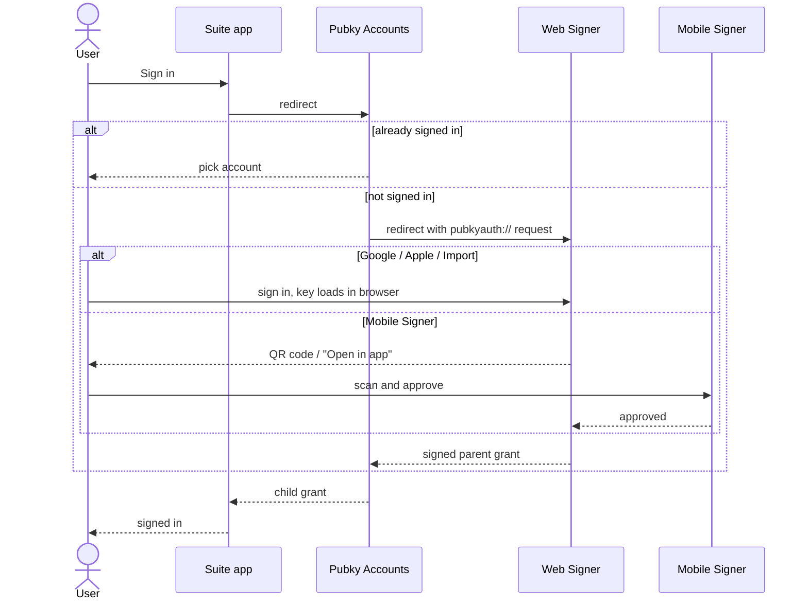
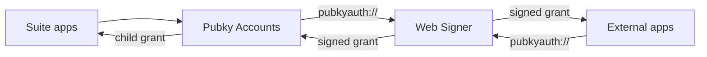
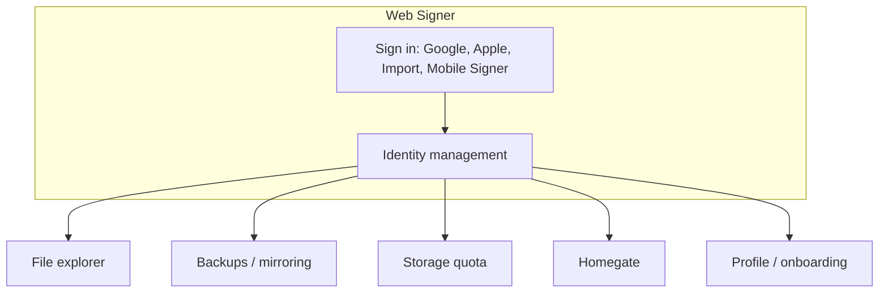
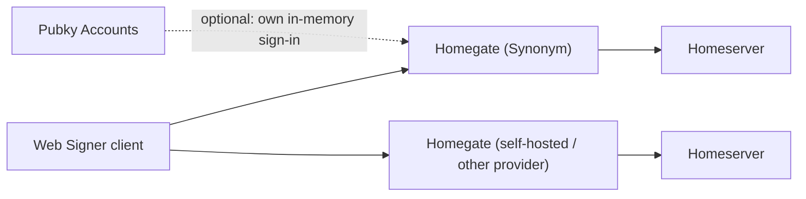
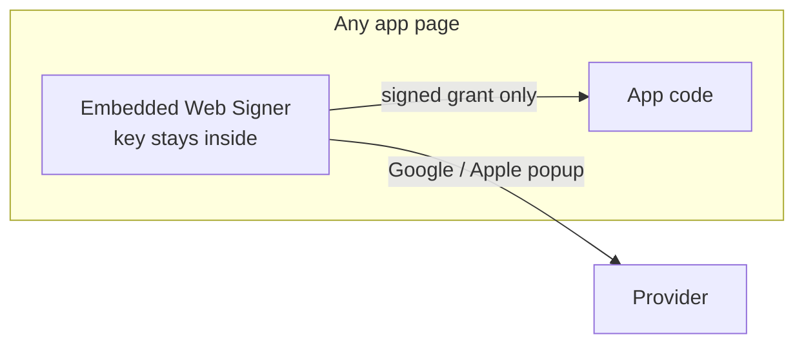

# RFC: Web Signer and Pubky Accounts

Status: Draft. Anything not marked Live is a proposal.

## Purpose

This RFC proposes how the Web Signer and Pubky Accounts work together:

- How people sign in to the Pubky suite.
- What the Web Signer is responsible for.
- Which alternatives we could choose instead.

It's meant for discussion. Nothing in it changes current behavior.

## Terms

- Signer: an app that holds your pubky key and approves sign-in requests.
  - Mobile Signer: Pubky Ring or Bitkit.
  - Web Signer: Pubky Passport, which runs in the browser.
- Pubky Accounts: the shared sign-in site for the Pubky suite, which is the set of apps Synonym runs. Accounts isn't a Signer.
- Parent grant: a single approval from a Signer that lets Accounts act for you.
- Child grant: a grant that Accounts gives each suite app. Accounts signs it with its own key, not yours.
- External app: an app outside the Pubky suite.

## Problems

- Getting started is hard. Before you can try an app, you have to install a Mobile Signer and create a pubky.
- Apps are disconnected. Each app signs you in separately, so signing in to one app doesn't sign you in to the next.
- The ecosystem is hard to see. Our apps don't look like one suite, and builders don't see that they can build on the same stack.

## Current behavior (Live)

- You can sign in to the Web Signer with a Google Account. Apple Account sign-in is on staging.
- The Web Signer keeps your key in the browser and saves an encrypted backup in your Google Drive or iCloud. If you sign in again with the same account, the Web Signer restores the key from that backup.
- You can import an existing pubky with a recovery phrase or a recovery file.
- New sign-ups are closed.
- The Web Signer has no onboarding, profile setup, or homeserver management.

## Proposal: the Web Signer handles every sign-in

The Web Signer's main job is sign-in with a cloud account such as Google or Apple. It keeps your private key in the browser. You can also import a key directly.

Pubky Accounts always uses the Web Signer to sign you in. The Web Signer page shows every option in one place: the Mobile Signer QR code, Continue with Google, Continue with Apple, and Import.

### Sign-in flow for suite apps

1. In a suite app, you select Sign in. The app redirects you to Accounts.
2. If you're already signed in to Accounts, you pick an account and skip to step 5.
3. Otherwise, Accounts creates a `pubkyauth://` request and redirects you to the Web Signer.
4. You sign in with Google, Apple, or an imported key, or you approve the request in a Mobile Signer. The Web Signer returns the signed parent grant to Accounts.
5. Accounts gives the app a child grant, and you're signed in.

### Sign-in flow for external apps

External apps skip Accounts. They send their own `pubkyauth://` request straight to the Web Signer and get the signed grant back.

### Later: identity management in the Web Signer

The Web Signer could become the place where you manage your pubky identity. This isn't limited to keys held in the Web Signer. If you use a Mobile Signer, you can sign in to the Web Signer with a grant and use the same tools:

- Homeserver file explorer.
- Backups.
- Homeserver mirroring.
- Storage quota.
- An interface for Homegate.
- Onboarding to create and edit your profile. Each app decides whether it requires a profile.
- Locked storage that protects keys in the browser with a PIN, a passkey, or biometrics.
- A "Keep keys in this browser" option. If you turn it off, the Web Signer uses a grant for everyday tasks and loads the key only when it needs to sign. This works only for Google and Apple identities, because imported keys have no cloud backup to reload from.

### Self-hosting

You could run your own Web Signer and point apps at it. A Google or Apple identity is tied to the Web Signer instance that created it. To move it to another instance, export a recovery file and import it there.

## Alternative: move the Web Signer backend into Homegate

The Web Signer has a small backend. It checks your Google or Apple sign-in and returns the key that unlocks your backup. In this alternative, Homegate provides that backend instead.

Benefits:

- The Web Signer becomes a frontend for any Homegate and the options it offers.
- You could self-host the backend, or use a provider other than Synonym, and switch providers later.
- Accounts could run the Google and Apple sign-in itself, in memory, without redirecting you to the Web Signer.

Tradeoffs:

- If Accounts also runs the sign-in, every provider change must be built and maintained in both Accounts and the Web Signer.
- Two sites would handle private keys, which doubles what needs security review.
- It isn't clear that Accounts needs its own sign-in.

## UX constraint: sign-in on the app's own page

Ideally, every option would sit on one page in the same tab, and any app could add the Web Signer to its own page. That constraint is what separates the options above.

Today, Google and Apple sign-in must start from a click on a page that carries the Web Signer's key code and provider setup. That's why apps redirect you to the Web Signer instead of showing the buttons themselves.

### To explore: an embedded Web Signer

An app page embeds the Web Signer in an iframe. You sign in inside the iframe. The app gets the signed grant but never has access to the key.

Before choosing this option, we need to answer these questions:

- Browsers give an embedded page separate storage for each site that embeds it. A Google or Apple identity would be restored from its cloud backup on each new site. An imported key would have to be imported again on each site.
- Do Google and Apple sign-in work from inside an iframe in every browser we support?
- The Web Signer would have to allow embedding, limited to sites we trust.

## Open questions

- After one approval, Accounts holds read and write access to `/pub` and `/priv` for up to two years. How do we show this to people, and should the period be shorter?
- Does Accounts need its own sign-in page, or is a redirect to the Web Signer enough?
- Who would run Homegate-based Web Signer backends other than Synonym, and how would someone switch providers?
