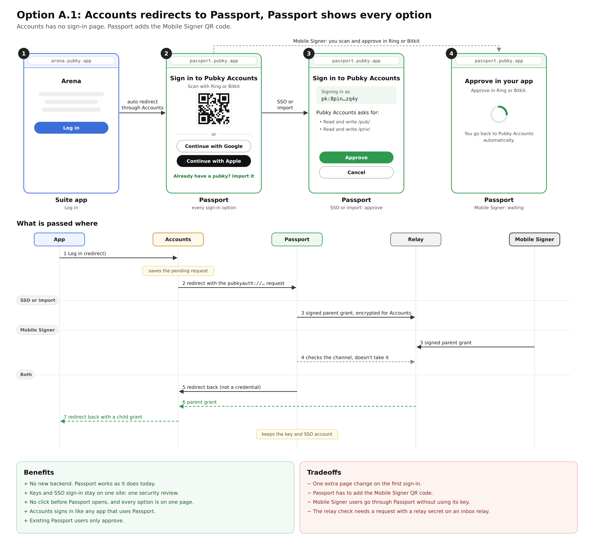
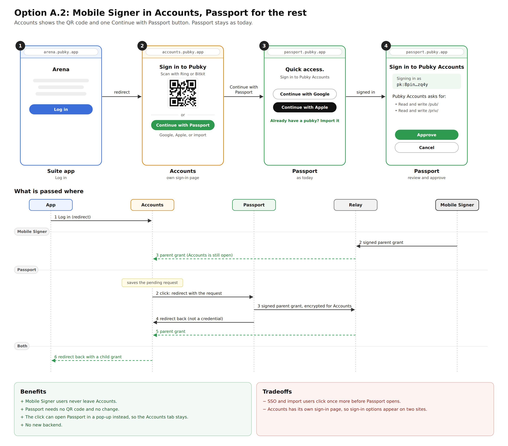
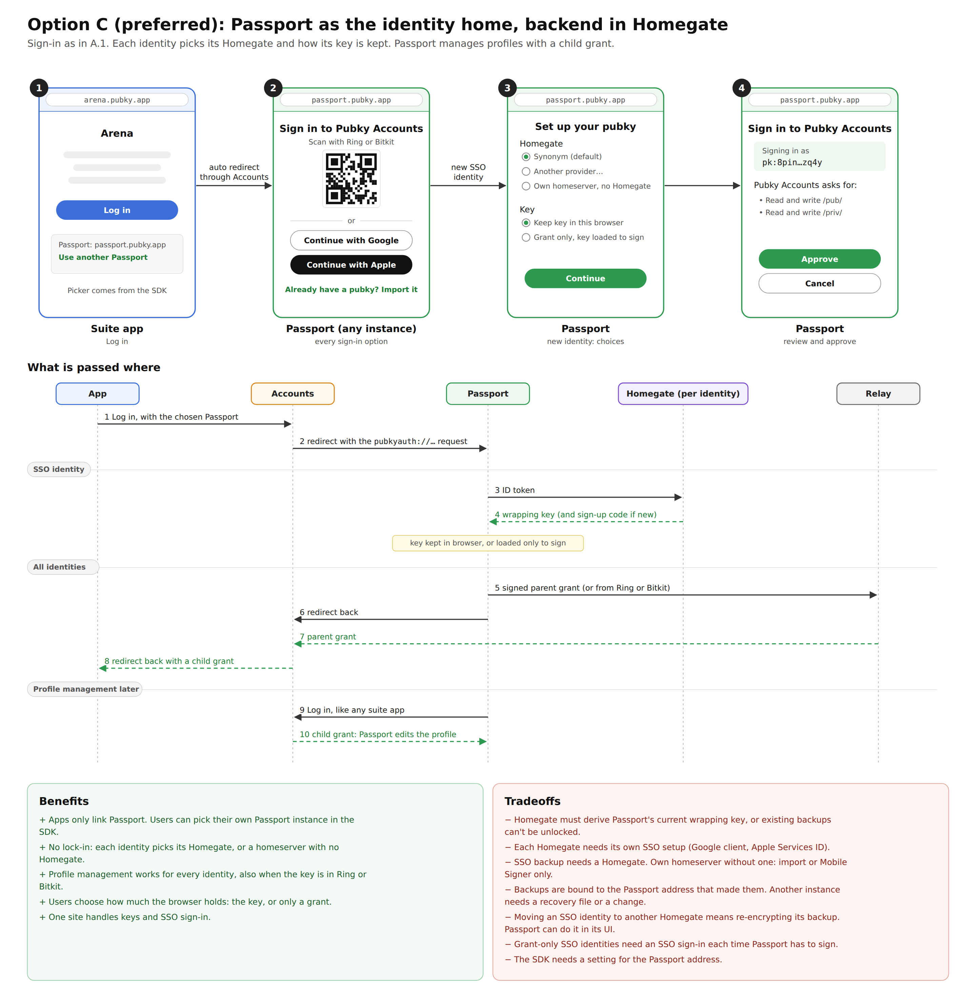

# RFC: Passport and Pubky Accounts

Status: Draft. Anything not marked Live is a proposal.

## Purpose

This RFC covers how Pubky Accounts and Passport work together:

- The options for how Accounts gets you signed in through Passport.
- The preferred design (Option C), where Passport becomes the home for your identity.

It's meant for discussion. Nothing in it changes current behavior.

## Terms

- Signer: an app that holds your pubky key and approves sign-in requests.
  - Mobile Signer: Pubky Ring or Bitkit.
  - Passport (Pubky Passport): the Signer that runs in the browser.
- Pubky Accounts: the shared sign-in site for the Pubky suite, which is the set of apps Synonym runs. Accounts isn't a Signer.
- Parent grant: a single approval from a Signer that lets Accounts act for you.
- Child grant: a grant that Accounts gives each suite app. Accounts signs it with its own key, not yours.
- Relay: the server that carries the signed approval from the Signer back to the app that asked for it.
- SSO provider: a cloud account you sign in to Passport with. Passport also saves your encrypted backup in that provider's cloud storage. The current options are Google (backup in Google Drive) and Apple (backup in iCloud).
- Local identity: a pubky whose key Passport keeps in this browser's local storage, whatever its source (SSO provider or import).
  - SSO identity: a local identity that is attached to an SSO provider, so its key can be restored from the backup there.
  - Local-only identity: a local identity that isn't attached to an SSO provider. Its key exists only in this browser, unless you saved a recovery phrase or recovery file.
- Wrapping key: the key that unlocks your encrypted backup. A server derives it after it checks your SSO provider sign-in.
- Homegate: the sign-up service in front of a homeserver.
- External app: an app outside the Pubky suite.

## Problems

- Getting started is hard. Before you can try an app, you have to install a Mobile Signer and create a pubky.
- Apps are disconnected. Each app signs you in separately, so signing in to one app doesn't sign you in to the next.
- The ecosystem is hard to see. Our apps don't look like one suite, and builders don't see that they can build on the same stack.

## Current behavior (Live)

- You can sign in to Passport with an SSO provider. Apple is on staging so far; production shows Google only.
- Passport keeps your key in the browser as a local identity and saves an encrypted backup with your SSO provider. If you sign in again with the same account, Passport restores the key from that backup.
- Passport's server checks your SSO provider sign-in and returns the wrapping key. It never sees the backup or your key.
- You can import an existing pubky with a recovery phrase or a recovery file.
- You can attach a local-only identity, such as an imported one, to an SSO provider. Passport then saves its encrypted backup there, and you can sign in with that provider from then on.
- Apps open Passport with a `pubkyauth://` request. Passport sends the signed approval through the relay, and the app never gets your key or your SSO account.
- Passport has no onboarding, profile setup, or homeserver management.

## Options

Every option shares these parts:

- In a suite app, you select Log in, and the app sends you to Accounts.
- Accounts holds one account at a time. If you're already signed in, it sends you straight back with a child grant.
- Accounts keeps only the parent grant and its own key, never your pubky key.
- External apps skip Accounts and send their `pubkyauth://` request straight to Passport.

Each figure shows the sign-in screens on top, what is passed where in the middle, and the benefits and tradeoffs at the bottom. The screens are basic mockups, not designs.

### Option A.1: Accounts redirects to Passport, Passport shows every option

Accounts has no sign-in page. It redirects you to Passport right away, and Passport shows the Mobile Signer QR code next to the SSO providers and Import. For a Mobile Signer, Passport checks the relay channel without taking the approval and returns you to Accounts on its own.

### Option A.2: Mobile Signer in Accounts, Passport for the rest

Accounts shows its own page with the Mobile Signer QR code and one Continue with Passport button. Passport stays as it is today.

### Option B: Passport sign-in inside Accounts

Accounts runs SSO sign-in itself, unlocks the key in memory, and signs the parent grant. The wrapping key endpoint moves from Passport's server into Homegate, so both sites use the same backend.

### Option C (preferred): Passport as the home for your identity

Pubky is moving to many apps, so profile management and onboarding shouldn't stay in pubky.app. Apps from other developers should be able to hand them to a drop-in solution. Option C makes Passport that place:

- Sign-in works as in A.1.
- The wrapping key endpoint moves into Homegate.
- Apps only link to Passport. Through the SDK, users can choose their own Passport instance.
- Each identity picks its Homegate: Synonym's, another provider's, or a self-hosted one. An identity on its own homeserver can also have no Homegate.
- Passport handles profile management. It signs in to Accounts like any suite app and gets a child grant, so this works for every identity, including ones whose key is in Ring or Bitkit.
- For each identity, you choose how Passport holds it: the key in this browser, or only a grant. A grant can come from Ring, Bitkit, or another Signer. For an SSO identity, Passport loads the key from the backup into memory when it needs to sign.

A.1 needs no backend change, so it can ship first. C builds on it.

We don't plan to embed Passport in an iframe. Browsers handle iframe storage and SSO provider sign-in differently, so it wouldn't work the same everywhere.
