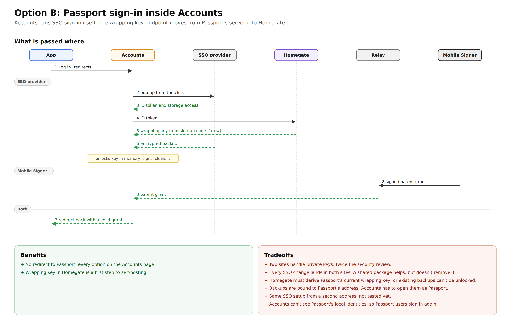
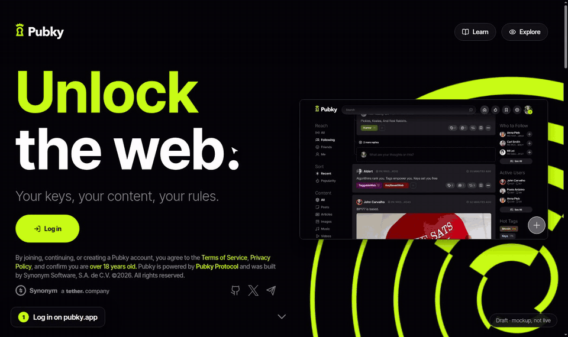
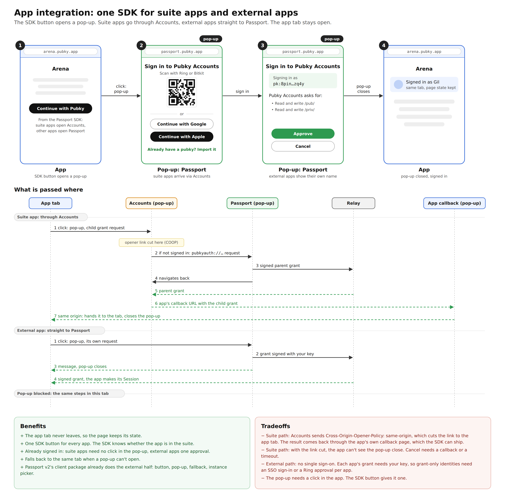

# RFC: Passport and Pubky Accounts

Status: Draft. Anything not marked Live is a proposal.

## Purpose

This RFC is mainly about how Pubky Accounts signs you in through Passport. It also lays the technical basis for Passport to become, later, the place where you manage your pubky.

It's meant for discussion. Nothing in it changes current behavior.

## Terms

- Signer: an app that holds your pubky key and approves sign-in requests.
  - Mobile Signer: Pubky Ring or Bitkit.
  - Passport (Pubky Passport): the Signer that runs in the browser.
- Pubky Accounts: the shared sign-in site for the Pubky suite, the set of apps Synonym runs. Accounts isn't a Signer.
- Parent grant: one approval from a Signer that lets Accounts act for you.
- Child grant: a grant Accounts gives each suite app, signed with Accounts' own key, not yours.
- Relay: the server that carries the signed approval from the Signer back to the app that asked for it.
- SSO provider: the cloud account you sign in to Passport with, which also stores your encrypted backup. Today: Google (Google Drive) and Apple (iCloud).
- Local identity: a pubky whose key Passport keeps in this browser. An SSO identity is attached to an SSO provider; a local-only identity isn't.
- Wrapping key: the key that unlocks your encrypted backup. A server derives it after it checks your SSO provider sign-in.
- Homegate: the sign-up service in front of a homeserver.
- External app: an app outside the Pubky suite.

## Problems

- Getting started is hard. You have to install a Mobile Signer and create a pubky before you can try an app.
- Apps are disconnected. Signing in to one app doesn't sign you in to the next.
- Our apps don't look like one suite, and builders don't see that they can build on the same stack.

## Current behavior (Live)

- You can sign in to Passport with an SSO provider. Apple is on staging so far; production shows Google only.
- Passport keeps the key in the browser and saves an encrypted backup with the SSO provider. Signing in again with the same account restores the key.
- Passport's server checks the SSO provider sign-in and returns the wrapping key. It never sees the backup or the key.
- You can import a pubky with a recovery phrase or recovery file, and attach a local-only identity to an SSO provider.
- Apps open Passport with a `pubkyauth://` request. Passport sends the signed approval through the relay; the app never gets your key or your SSO account.
- Passport has no onboarding, profile setup, or homeserver management.

## Options

Every option shares these parts:

- In a suite app, you select Log in, and the app sends you to Accounts.
- Accounts holds one account. If you're already signed in, it sends you straight back with a child grant.
- Accounts keeps only the parent grant and its own key, never your pubky key.
- External apps skip Accounts and send their `pubkyauth://` request straight to Passport.

Each figure shows the sign-in screens, what is passed where, and the benefits and tradeoffs. The screens are basic mockups, not designs.

### Option A.1: Accounts redirects to Passport, Passport shows every option

Accounts has no sign-in page. It redirects you to Passport right away, and Passport shows the Mobile Signer QR code next to the SSO providers and Import. For a Mobile Signer, Passport checks the relay channel without taking the approval and returns you to Accounts on its own.

Mockup, not live:

### Option A.2: Mobile Signer in Accounts, Passport for the rest

Accounts shows its own page with the Mobile Signer QR code and one Continue with Passport button. Passport stays as it is today.

Mockup, not live:

### Option B: Passport sign-in inside Accounts

Accounts runs SSO sign-in itself, unlocks the key in memory, and signs the parent grant. The wrapping key endpoint moves from Passport's server into Homegate, so both sites use the same backend.

Mockup, not live:

### App integration

Apps add one button from a Passport SDK, as the Passport v2 client package already does for Passport alone. The button opens a pop-up, and the app tab never leaves.

- Suite apps: the pop-up opens Accounts, which sends it on to Passport if you aren't signed in, then to the app's callback page with the child grant.
- External apps: the pop-up opens Passport directly and the app gets its own grant.
- If a pop-up can't open, the same steps run in the tab.

We don't plan to embed Passport in an iframe. Browsers handle iframe storage and SSO provider sign-in differently, so it wouldn't work the same everywhere.

## Later: Passport as the front end for Homegate

Lower priority than the sign-in above, and not a fixed design. Pubky is moving to many apps, so sign-up and onboarding shouldn't stay in pubky.app. Passport could become the front end for Homegate and the place where you manage your pubky, also for apps from other developers.

What the sign-in options already give it:

- New SSO users sign up in Passport, so onboarding steps could sit between sign-up and the grant review.
- Passport could sign in to Accounts like any suite app and get a child grant. Managing your pubky would then also work when the key is in Ring or Bitkit.

Some examples of what it could offer:

- The onboarding pubky.app has today, such as profile setup, moved into Passport.
- Sign-up with a Mobile Signer: Passport gets the sign-up code from Homegate and hands it to Ring, which creates the pubky.
- Editing your profile, and seeing your storage, backups, and authorized apps in one place.

Mockup, not live. The A.1 sign-in with profile setup inside Passport:

