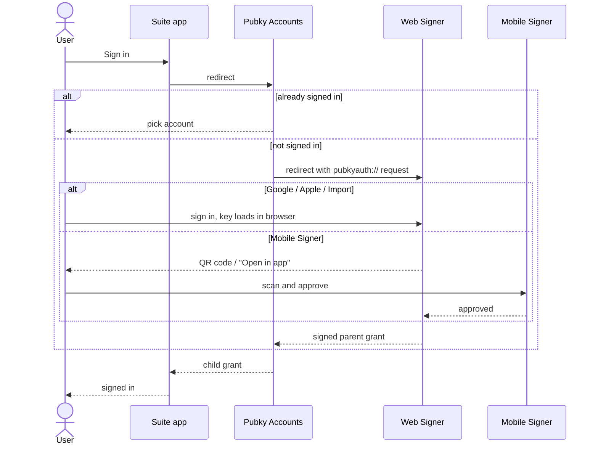
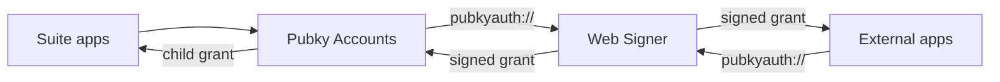
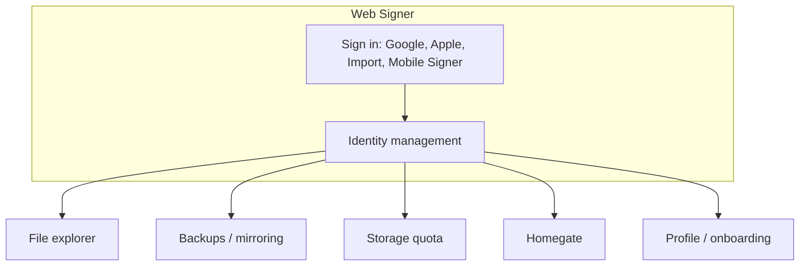
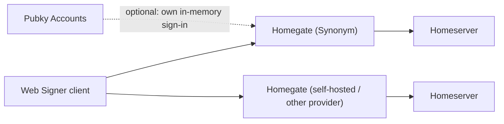
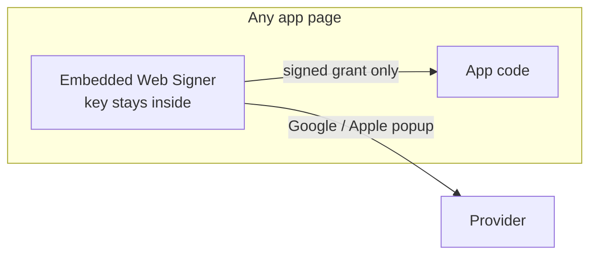

# Pubky Signers and Pubky Accounts

**Status: Draft.** Anything not marked Live is a proposal.

## Terms

- **Signer**: an app that holds a user's pubky key and approves sign-in requests.
  - **Mobile Signer**: Pubky Ring, Bitkit.
  - **Web Signer**: Pubky Passport, in the browser.
- **Pubky Accounts**: the shared sign-in site for the Pubky suite (apps Synonym runs). It isn't a Signer.
- **Parent grant**: one approval from a Signer that lets Accounts act for the user.
- **Child grant**: a grant Accounts gives each suite app, signed with Accounts' own key.

## Problems

- **Getting started is hard.** A newcomer has to install a Mobile Signer and create a pubky before trying an app.
- **Apps are disconnected.** Each app signs you in on its own, so signing in once doesn't carry over.
- **The ecosystem is hard to see.** Our apps don't read as one suite, and builders don't see that they can join the same stack.

## Web Signer today (Live)

- Sign in with a Google Account, which is Live. Apple Account sign-in is on staging.
- The key stays in the browser, with an encrypted backup in the user's Google Drive or iCloud. Signing in again with the same account restores it.
- An existing pubky can be imported with a recovery phrase or recovery file.
- New sign-ups are closed for now.
- No onboarding yet: no profile setup and no homeserver management.

## Main proposal: Web Signer first

The Web Signer is first of all a sign-in that uses a cloud account (Google, Apple). It keeps the private key in the browser, and you can also import a key directly.

Pubky Accounts always uses the Web Signer to sign in. The Web Signer page shows every option in one place: the Mobile Signer QR code, Continue with Google, Continue with Apple, and Import.

External apps (not in the suite) skip Accounts. They send their own `pubkyauth://` request straight to the Web Signer.

## What the Web Signer can become (Proposed)

The place where people manage their pubky identity. It isn't only for Web Signer keys: someone using a Mobile Signer can sign in to the Web Signer with a grant and use the same tools.

- Homeserver file explorer
- Backups
- Homeserver mirroring
- Storage quota
- An interface for Homegate
- Onboarding: create and edit the profile. Each app decides whether it requires a profile.
- Locked storage: PIN or passkey/biometrics to protect keys kept in the browser
- "Keep keys in this browser" option: if off, the Web Signer works from a grant for everyday tasks and loads the key only to sign. Works for Google/Apple identities, not imported ones.

**Self-hosting.** Someone could run their own Web Signer and point apps at it. Google/Apple identities are tied to the Web Signer instance that created them, so moving one means exporting a recovery file and importing it into the new instance.

## Alternative: Web Signer backend in Homegate

Today the Web Signer has its own small backend. It checks the Google/Apple sign-in and returns the key that unlocks the backup. This alternative moves that backend into Homegate.

- The Web Signer becomes a frontend for any Homegate and the options that Homegate offers.
- You could self-host it, or use another provider instead of us, and switch later.
- Accounts could then run the Google/Apple sign-in itself, in memory, without sending people to the Web Signer.
- Downside: if Accounts does it too, every provider change has to be built and maintained in two places, and two sites handle private keys. It's not clear this is needed.

## UX question: sign-in on the app's own page

Ideally all options sit on one page in the same tab, and the Web Signer can be added to any page. This is what makes the options above differ. Today, Google/Apple sign-in has to start from a click on a page that carries the Web Signer's key code and provider setup. That's why apps send people to the Web Signer instead of showing the buttons themselves.

**To explore: an embedded Web Signer (iframe).** The page embeds the Web Signer. The user signs in inside it, and the page gets the signed grant but never touches the key.

Questions to answer before choosing it:

- Browsers give an embedded page separate storage for each site that embeds it. A Google/Apple identity would be restored from its cloud backup on each new site. An imported key would have to be imported again on each site.
- We need to check whether Google and Apple sign-in work from inside an iframe in every browser we support.
- The Web Signer would have to allow being embedded, and only by sites we trust.

## Open questions

- Accounts holds read/write access to `/pub` and `/priv` for up to 2 years after one approval. How do we show that to people, and should it be shorter?
- Do we need Accounts to sign in on its own page, or is a redirect to the Web Signer good enough?
- Who runs Homegate-based Web Signer backends other than us, and how does someone switch?
