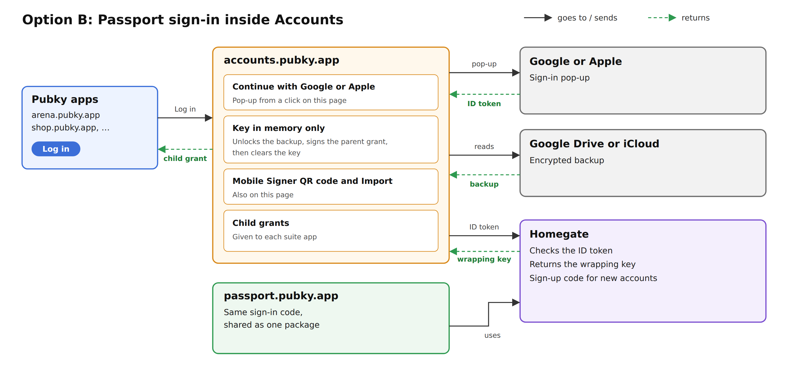
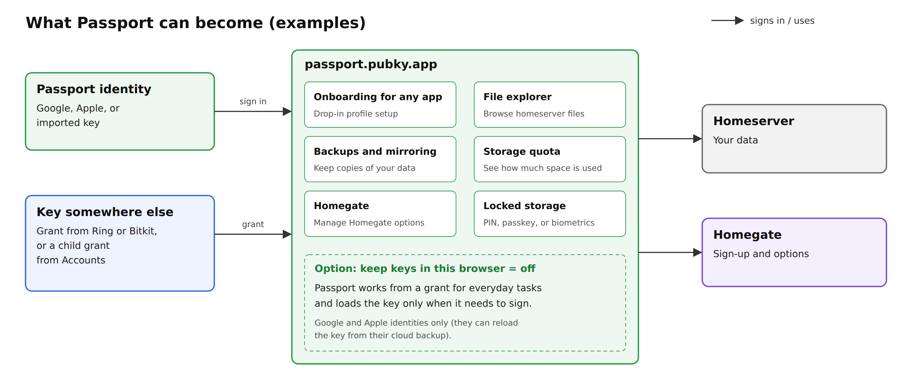

# RFC: Passport and Pubky Accounts

Status: Draft. Anything not marked Live is a proposal.

## Purpose

This RFC covers how Pubky Accounts and Passport work together:

- Two options for how Accounts gets you signed in through Passport, and what each one passes where.
- Which option to start with.
- What Passport can become after that.

It's meant for discussion. Nothing in it changes current behavior.

## Terms

- Signer: an app that holds your pubky key and approves sign-in requests.
  - Mobile Signer: Pubky Ring or Bitkit.
  - Passport (Pubky Passport): the Signer that runs in the browser.
- Pubky Accounts: the shared sign-in site for the Pubky suite, which is the set of apps Synonym runs. Accounts isn't a Signer.
- Parent grant: a single approval from a Signer that lets Accounts act for you.
- Child grant: a grant that Accounts gives each suite app. Accounts signs it with its own key, not yours.
- Relay: the server that carries the signed approval from the Signer back to the app that asked for it.
- Wrapping key: the key that unlocks your encrypted backup in Google Drive or iCloud. A server derives it after it checks your Google or Apple sign-in.
- External app: an app outside the Pubky suite.

## Problems

- Getting started is hard. Before you can try an app, you have to install a Mobile Signer and create a pubky.
- Apps are disconnected. Each app signs you in separately, so signing in to one app doesn't sign you in to the next.
- The ecosystem is hard to see. Our apps don't look like one suite, and builders don't see that they can build on the same stack.

## Current behavior (Live)

- You can sign in to Passport with a Google or Apple Account.
- Passport keeps your key in the browser and saves an encrypted backup in your Google Drive or iCloud. If you sign in again with the same account, Passport restores the key from that backup.
- Passport's server checks your Google or Apple sign-in and returns the wrapping key. It never sees the backup or your key.
- You can import an existing pubky with a recovery phrase or a recovery file.
- Apps open Passport with a `pubkyauth://` request. Passport sends the signed approval through the relay, and the app never gets your key or your Google or Apple Account.
- Passport has no onboarding, profile setup, or homeserver management.

## How Accounts signs you in

Both options below share these parts:

- In a suite app, you select Sign in, and the app sends you to Accounts.
- Accounts holds one account at a time. If you're already signed in, it sends you straight back to the app with a child grant, without asking.
- Accounts keeps only the parent grant and its own key. It never stores your pubky key.
- External apps skip Accounts. They send their own `pubkyauth://` request to Passport and get the signed grant back.

The options differ in where the sign-in itself happens.

### Option A: Accounts redirects to Passport

Accounts sends you to Passport, and Passport sends you back. Accounts signs in through Passport the same way any other app does.

1. Accounts creates a `pubkyauth://` request for a parent grant and saves the pending request in the browser.
2. Accounts redirects you to Passport, with the request in the address.
3. You sign in with Google, Apple, or an imported key. If you already have an identity in Passport, you skip this step.
4. You review the request and approve it.
5. Passport sends the signed parent grant through the relay, then redirects you back to Accounts.
6. Accounts picks up the saved request, receives the parent grant from the relay, and sends you on with a child grant.

What is passed where:

- Accounts to Passport: the `pubkyauth://` request (requested access, relay address, and the address to return to).
- Passport to the relay: the signed parent grant, encrypted for Accounts.
- Passport to Accounts: a redirect back. The redirect isn't a credential. Accounts trusts only what it gets from the relay.
- Stays in Passport: your key and your Google or Apple Account.

Benefits:

- No new backend. Passport works as it does today.
- Keys and Google and Apple sign-in stay on one site, so only one site needs security review for them.
- Signing in to Accounts looks and works like signing in to any app that uses Passport.
- If you already use Passport in this browser, signing in to Accounts takes one approval.

Tradeoffs:

- You see one extra page change on your first sign-in.
- Passport would need to show the Mobile Signer QR code for the same request. Ring or Bitkit sends the approval to the relay, not to Passport, so Passport needs a way to send you back to Accounts after you approve, such as a button.

Accounts could open Passport in a pop-up instead of a redirect. The existing Passport button package does this. A pop-up needs a click on the Accounts page first, though, so Accounts would show a page with a single button. A redirect needs no click.

### Option B: Passport sign-in inside Accounts

Accounts shows Continue with Google, Continue with Apple, the Mobile Signer QR code, and Import on its own page. The wrapping key endpoint moves from Passport's server into Homegate, so Accounts and Passport use the same backend.

1. You select Continue with Google or Continue with Apple on the Accounts page. The provider opens in a pop-up.
2. Accounts sends the provider's ID token to Homegate. Homegate checks it and returns the wrapping key. For a new account, Homegate also returns a sign-up code.
3. Accounts reads your encrypted backup from Google Drive or iCloud and unlocks it in memory.
4. Accounts signs the parent grant with your key, then clears the key.
5. Accounts sends you on with a child grant.

What is passed where:

- Google or Apple to Accounts: an ID token, plus access to the backup in Drive or iCloud.
- Accounts to Homegate: the ID token. Homegate returns the wrapping key.
- Drive or iCloud to Accounts: the encrypted backup.
- Stays in Accounts' memory for a moment: your key. It's cleared after signing.

Benefits:

- No redirect. Every option is on the Accounts page, in the same tab.
- Moving the wrapping key into Homegate is also the first step toward self-hosting (see below).

Tradeoffs:

- Two sites handle private keys, which doubles what needs security review.
- Every provider change must land in both sites. Sharing Passport's sign-in code as one package reduces this but doesn't remove it.
- Homegate must derive the same wrapping key as Passport's server does today. Otherwise existing backups can't be unlocked.
- Each backup is tied to Passport's address today, and Passport checks that address when it opens a backup. Accounts would have to open backups as Passport, which needs a change and its own review.
- Both sites must use the same Google client and Apple Services ID to reach the same backup. Access from a second address hasn't been tested yet.
- Accounts doesn't see the identities Passport keeps in the browser. Someone already signed in to Passport signs in again with Google or Apple.

### Recommendation

Start with Option A. It needs no new backend, and Accounts uses Passport like any other app. If the redirect turns out to cause friction, move to Option B.

We don't plan to embed Passport in an iframe. Browsers handle iframe storage and Google and Apple sign-in differently, so it wouldn't work the same everywhere.

## What Passport can become

Pubky is moving to many apps. Profile management and onboarding then shouldn't stay in pubky.app. Apps from other developers should also be able to hand onboarding to a drop-in solution. Passport can be that place.

Passport could become the place where you manage your pubky identity. It isn't limited to keys held in Passport: if your key is somewhere else, you can sign in to Passport with a grant and use the same tools. The grant can come straight from your Mobile Signer, or be a child grant from Accounts if you're already signed in there.

Some examples of what it could offer:

- Onboarding and profile setup that any app can use. Each app decides whether it requires a profile.
- Homeserver tools, such as a file explorer, backups, mirroring, and storage quota.
- An interface for Homegate.
- Stronger key protection in the browser, such as a PIN, a passkey, or biometrics.
- Not keeping keys in the browser. Passport would use a grant for everyday tasks and load the key only when it needs to sign. This works only for Google and Apple identities, because they can reload the key from their cloud backup.

### Self-hosting

With the wrapping key in Homegate, Passport becomes a frontend for any Homegate. You could self-host Homegate, or use a provider other than Synonym. Each Homegate needs its own Google and Apple setup.

A Google or Apple identity is tied to the backend that created it. To move it to another one, export a recovery file and import it there. This could be handled inside the Passport UI.
