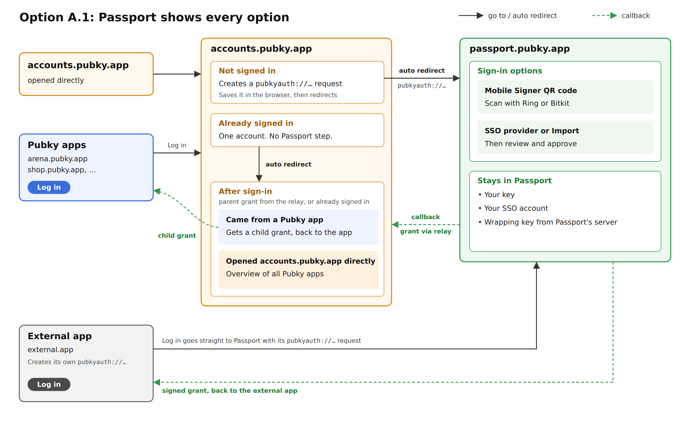
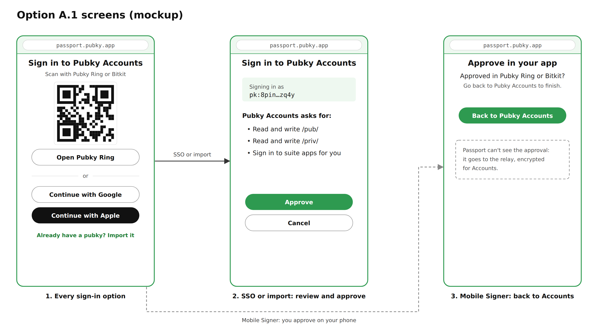
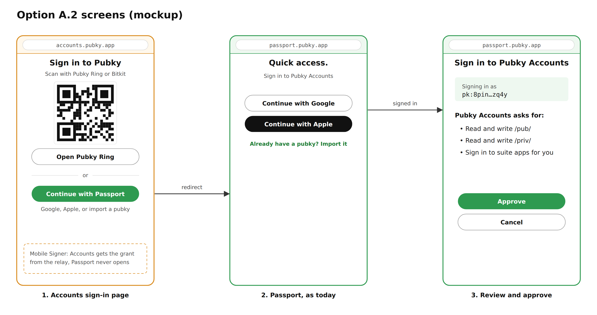
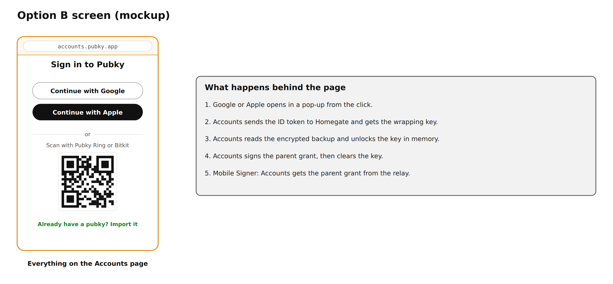

# RFC: Passport and Pubky Accounts

Status: Draft. Anything not marked Live is a proposal.

## Purpose

This RFC covers how Pubky Accounts and Passport work together:

- Two options for how Accounts gets you signed in through Passport, and what each one passes where.
- Which option to start with.
- What Passport can become after that.

It's meant for discussion. Nothing in it changes current behavior.

## Terms

- Signer: an app that holds your pubky key and approves sign-in requests.
  - Mobile Signer: Pubky Ring or Bitkit.
  - Passport (Pubky Passport): the Signer that runs in the browser.
- Pubky Accounts: the shared sign-in site for the Pubky suite, which is the set of apps Synonym runs. Accounts isn't a Signer.
- Parent grant: a single approval from a Signer that lets Accounts act for you.
- Child grant: a grant that Accounts gives each suite app. Accounts signs it with its own key, not yours.
- Relay: the server that carries the signed approval from the Signer back to the app that asked for it.
- SSO provider: a cloud account you sign in to Passport with. Passport also saves your encrypted backup in that provider's cloud storage. The current options are Google (backup in Google Drive) and Apple (backup in iCloud).
- Local identity: a pubky whose key Passport keeps in this browser's local storage, whatever its source (SSO provider or import).
  - SSO identity: a local identity that is attached to an SSO provider, so its key can be restored from the backup there.
  - Local-only identity: a local identity that isn't attached to an SSO provider. Its key exists only in this browser, unless you saved a recovery phrase or recovery file.
- Wrapping key: the key that unlocks your encrypted backup. A server derives it after it checks your SSO provider sign-in.
- External app: an app outside the Pubky suite.

## Problems

- Getting started is hard. Before you can try an app, you have to install a Mobile Signer and create a pubky.
- Apps are disconnected. Each app signs you in separately, so signing in to one app doesn't sign you in to the next.
- The ecosystem is hard to see. Our apps don't look like one suite, and builders don't see that they can build on the same stack.

## Current behavior (Live)

- You can sign in to Passport with an SSO provider. Apple is on staging so far; production shows Google only.
- Passport keeps your key in the browser as a local identity and saves an encrypted backup with your SSO provider. If you sign in again with the same account, Passport restores the key from that backup.
- Passport's server checks your SSO provider sign-in and returns the wrapping key. It never sees the backup or your key.
- You can import an existing pubky with a recovery phrase or a recovery file.
- You can attach a local-only identity, such as an imported one, to an SSO provider. Passport then saves its encrypted backup there, and you can sign in with that provider from then on.
- Apps open Passport with a `pubkyauth://` request. Passport sends the signed approval through the relay, and the app never gets your key or your SSO account.
- Passport has no onboarding, profile setup, or homeserver management.

## How Accounts signs you in

Both options below share these parts:

- In a suite app, you select Sign in, and the app sends you to Accounts.
- Accounts holds one account at a time. If you're already signed in, it sends you straight back to the app with a child grant, without asking.
- Accounts keeps only the parent grant and its own key. It never stores your pubky key.
- External apps skip Accounts. They send their own `pubkyauth://` request to Passport and get the signed grant back.

The options differ in where the sign-in itself happens.

### Option A: Accounts redirects to Passport

Accounts sends you to Passport for sign-in, and Passport sends you back. Accounts signs in through Passport the same way any other app does. A.1 and A.2 differ in where the Mobile Signer QR code is shown.

What is passed where, in both A.1 and A.2:

- Accounts to Passport: the `pubkyauth://` request (requested access, relay address, and the address to return to).
- Passport or the Mobile Signer to the relay: the signed parent grant, encrypted for Accounts.
- Passport to Accounts: a redirect back. The redirect isn't a credential. Accounts trusts only what it gets from the relay.
- Stays in Passport: your key and your SSO account.

Benefits of both:

- No new backend. Passport works as it does today.
- Keys and SSO provider sign-in stay on one site, so only one site needs security review for them.
- Signing in to Accounts looks and works like signing in to any app that uses Passport.
- If you already use Passport in this browser, signing in to Accounts takes one approval.

#### Option A.1: Passport shows every option

1. Accounts creates a `pubkyauth://` request for a parent grant and saves the pending request in the browser.
2. Accounts redirects you to Passport right away, with the request in the address.
3. Passport shows every sign-in option: the Mobile Signer QR code, the SSO providers, and Import.
4. You sign in:
   - With a Mobile Signer: you scan the QR code, or open the link on your phone, and approve in Ring or Bitkit. The Mobile Signer sends the signed parent grant to the relay, and Passport sends you back to Accounts.
   - With an SSO provider or an imported key: you sign in to Passport, review the request, and approve it. If you already have a local identity in Passport, you only review and approve. Passport sends the signed parent grant to the relay and redirects you back to Accounts.
5. Accounts picks up the saved request, receives the parent grant from the relay, and sends you on with a child grant.

Benefits:

- Accounts shows no sign-in page of its own, and you don't need to click anything before Passport opens.
- Every sign-in option is on one page.

Tradeoffs:

- You see one extra page change on your first sign-in.
- Passport needs to show the Mobile Signer QR code, which it doesn't do today.
- Ring or Bitkit sends the approval to the relay, not to Passport. Passport doesn't know when you've approved, so it needs a way to send you back to Accounts, such as a button.
- Mobile Signer users go through Passport even though they don't use its key.

#### Option A.2: Mobile Signer in Accounts, Passport for the rest

1. Accounts creates a `pubkyauth://` request for a parent grant.
2. Accounts shows its own sign-in page: the request as a Mobile Signer QR code, and a Continue with Passport button.
3. You sign in:
   - With a Mobile Signer: you scan the QR code, or open the link on your phone, and approve in Ring or Bitkit. The Mobile Signer sends the signed parent grant to the relay. Accounts is still open, receives it, and sends you on with a child grant. You never see Passport.
   - With Passport: you select Continue with Passport. Accounts saves the pending request and redirects you to Passport, which shows the SSO providers and Import, as it does today. You sign in, review the request, and approve it. Passport sends the signed parent grant to the relay and redirects you back to Accounts, which sends you on with a child grant.

Benefits:

- Mobile Signer users stay on the Accounts page.
- Accounts is already waiting on the relay when you approve in Ring or Bitkit, so there's no "back to Accounts" step.
- Passport doesn't need to show a QR code.

Tradeoffs:

- SSO and import users need one more click on the Accounts page before Passport opens.
- Accounts shows a sign-in page of its own, and sign-in options appear on two sites.

Because A.2 already has a click on the Accounts page, that click could open Passport in a pop-up instead of a redirect. The existing Passport button package does this, and you would never leave the Accounts tab. A.1 has no click, so it has to redirect: browsers block pop-ups that don't come from a click.

### Option B: Passport sign-in inside Accounts

Accounts shows the SSO provider buttons, the Mobile Signer QR code, and Import on its own page. The wrapping key endpoint moves from Passport's server into Homegate, so Accounts and Passport use the same backend.

1. You select an SSO provider on the Accounts page. The provider opens in a pop-up.
2. Accounts sends the provider's ID token to Homegate. Homegate checks it and returns the wrapping key. For a new account, Homegate also returns a sign-up code.
3. Accounts reads your encrypted backup from the provider's cloud storage and unlocks it in memory.
4. Accounts signs the parent grant with your key, then clears the key.
5. Accounts sends you on with a child grant.

What is passed where:

- SSO provider to Accounts: an ID token, plus access to the backup in its cloud storage.
- Accounts to Homegate: the ID token. Homegate returns the wrapping key.
- The provider's cloud storage to Accounts: the encrypted backup.
- Stays in Accounts' memory for a moment: your key. It's cleared after signing.

Benefits:

- No redirect. Every option is on the Accounts page, in the same tab.
- Moving the wrapping key into Homegate is also the first step toward self-hosting (see below).

Tradeoffs:

- Two sites handle private keys, which doubles what needs security review.
- Every SSO provider change must land in both sites. Sharing Passport's sign-in code as one package reduces this but doesn't remove it.
- Homegate must derive the same wrapping key as Passport's server does today. Otherwise existing backups can't be unlocked.
- Each backup is tied to Passport's address today, and Passport checks that address when it opens a backup. Accounts would have to open backups as Passport, which needs a change and its own review.
- Both sites must use the same SSO provider setup (today a Google client and an Apple Services ID) to reach the same backup. Access from a second address hasn't been tested yet.
- Accounts doesn't see Passport's local identities. Someone already signed in to Passport signs in again with their SSO provider.

### Recommendation

Start with Option A. It needs no new backend, and Accounts uses Passport like any other app. Whether to use A.1 or A.2 is still open. If the redirect turns out to cause friction, move to Option B.

We don't plan to embed Passport in an iframe. Browsers handle iframe storage and SSO provider sign-in differently, so it wouldn't work the same everywhere.

## What Passport can become

Pubky is moving to many apps. Profile management and onboarding then shouldn't stay in pubky.app. Apps from other developers should also be able to hand onboarding to a drop-in solution. Passport can be that place.

Passport could become the place where you manage your pubky identity. It isn't limited to local identities: if your key is somewhere else, you can sign in to Passport with a grant and use the same tools. The grant can come straight from your Mobile Signer, or be a child grant from Accounts if you're already signed in there.

Some examples of what it could offer:

- Onboarding and profile setup that any app can use. Each app decides whether it requires a profile.
- Homeserver tools, such as a file explorer, backups, mirroring, and storage quota.
- An interface for Homegate.
- Stronger key protection in the browser, such as a PIN, a passkey, or biometrics.
- Not keeping keys in the browser. Passport would use a grant for everyday tasks and load the key only when it needs to sign. This works only for SSO identities, because they can reload the key from their backup.

### Self-hosting

With the wrapping key in Homegate, Passport becomes a frontend for any Homegate. You could self-host Homegate, or use a provider other than Synonym. Each Homegate needs its own SSO provider setup.

An SSO identity is tied to the backend that created it. To move it to another one, export a recovery file and import it there. This could be handled inside the Passport UI.
