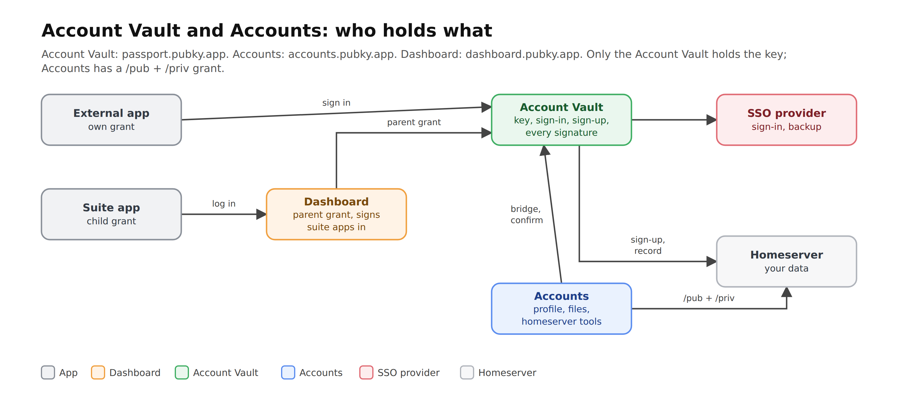
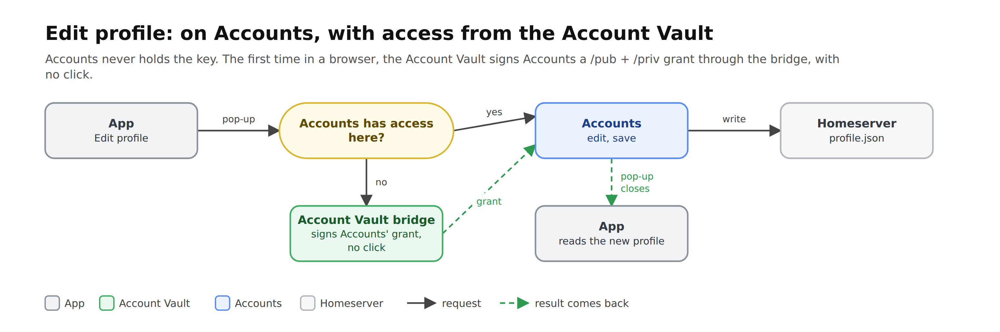
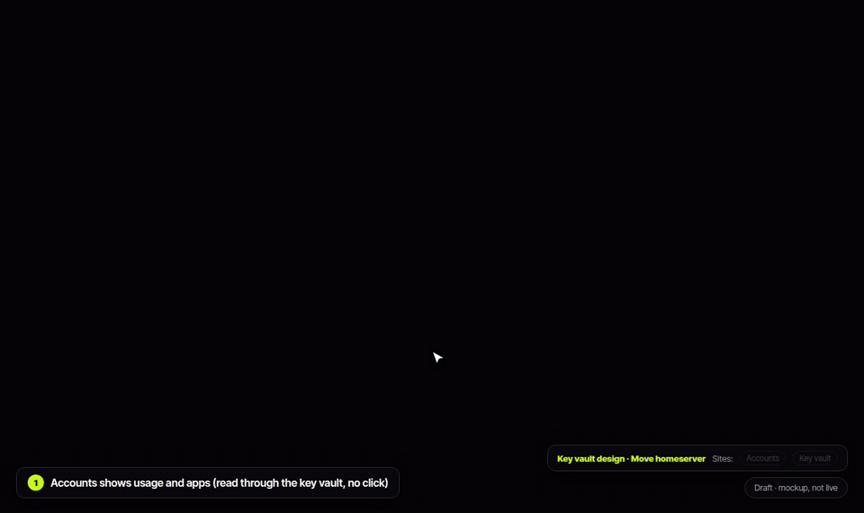
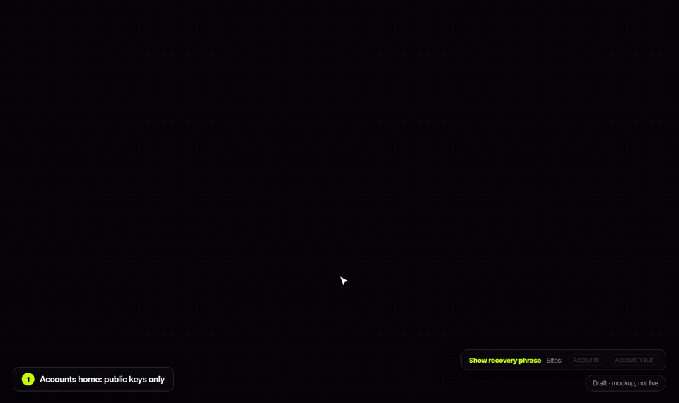
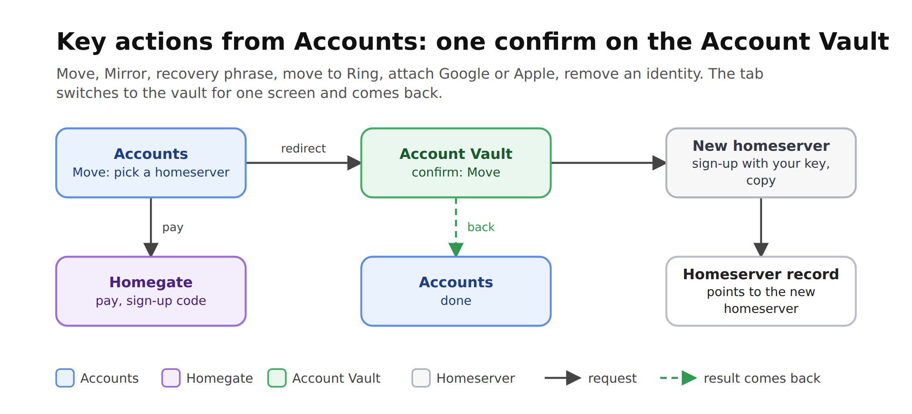
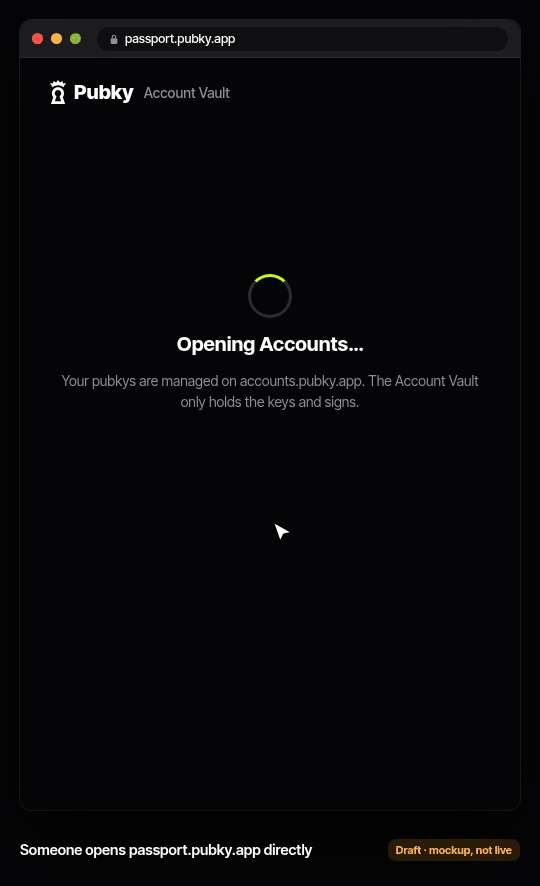
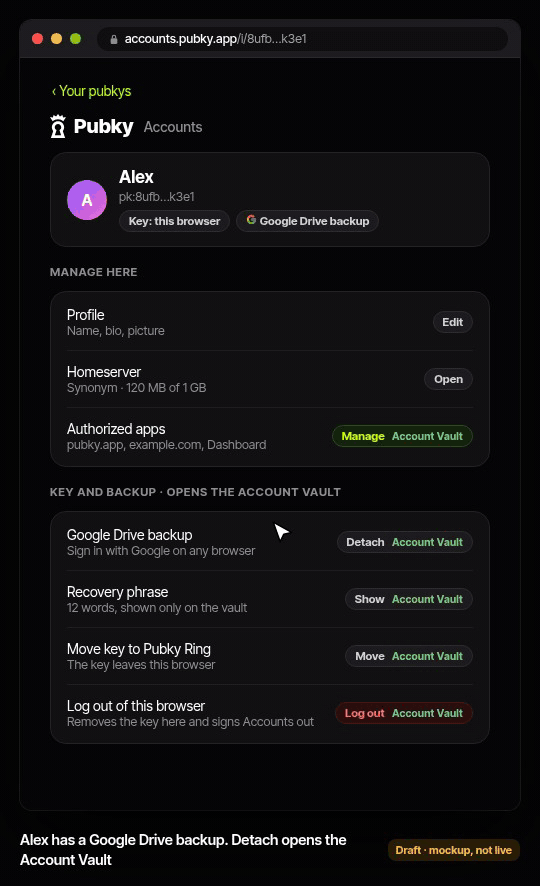
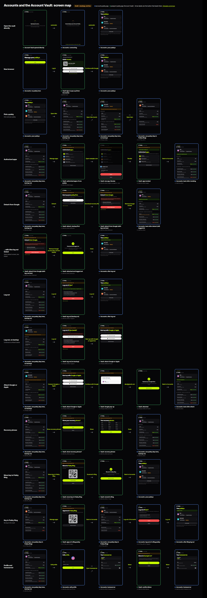

# Design: Account Vault and Accounts

The full design behind the "Account Vault and Accounts" section of [RFC 0002](0002-passport-vision.md). One codebase serves two sites, so the key never shares a site with profile, files or homeserver tools.

- **Pubky Account Vault** (`passport.pubky.app`, today's Passport): the key, Google and Apple sign-in and backup, the whole sign-in and sign-up pop-up, and every signature.
- **Pubky Accounts** (`accounts.pubky.app`): identities, profile editing, files and homeserver tools, with a `/pub/` + `/priv/` grant the Account Vault signs.
- **Pubky Dashboard** (`dashboard.pubky.app`, today's Pubky Accounts): the suite's sign-in. Only its address and name change.



## Why two hosts

Browsers keep `localStorage` and IndexedDB per origin (scheme, host and port). Two paths on one host share storage, so `accounts.pubky.app/vault` would give no isolation. Two subdomains don't share it. Both still sit under `pubky.app`, which browsers treat as one site (`pubky.app` isn't on the Public Suffix List).

The Account Vault stays at `passport.pubky.app`, because everything is already tied to that address:

- **Local keys** sit in `localStorage` on that host (`pubky-passport/local-identities/v1/…`). No other host can read them.
- **Backups** mix the Passport address into their encryption, and the iCloud store rejects backups from another address.
- **The SDK** (`@pubky/passport-auth`) opens `passport.pubky.app` by default.
- **Google and Apple** are registered for that address.

## What runs where

**Account Vault** (`passport.pubky.app`). The only code that touches a key, a recovery phrase, a wrapping key or a Google or Apple token.

- Key storage, on this host only.
- The sign-in screen: Mobile Signer QR code, Google, Apple, Import.
- Google and Apple: the sign-in pop-up, the backup in Drive or iCloud, the wrapping key route. Only this host is registered with them, so no other host can get an ID token. An ID token plus the backup is the key.
- Sign-up: the Homegate client and every method (SMS, Lightning, Google, Apple, invite code), key creation, sign-up on the homeserver, the backup, and the profile step. One Google ID token gets both the sign-up code and the backup key.
- Every signature and key action behind its own page: app grants, the Dashboard's parent grant, revoking apps, export, move to Ring, attach or detach Google or Apple, log out, and later Move and Mirror.
- The bridge (below).

**Accounts** (`accounts.pubky.app`). Everything that shows data from the homeserver.

- Your pubkys, from the bridge: public keys, labels and backup status only.
- Profile editing, files, homeserver usage, and the list of authorized apps (revoking opens the Account Vault).
- Its own homeserver session: a grant for client ID `accounts.pubky.app` with `/pub/:rw,/priv/:rw`, signed by the Account Vault.
- With the key in Ring: a child grant from the Dashboard, or a grant from the Mobile Signer.

**Dashboard** (`dashboard.pubky.app`). Redirects to the Account Vault for sign-in and the parent grant, as in RFC 0001.

## Same screens: what changes

- **Sign-in and sign-up pop-up:** no change, still `passport.pubky.app`.
- **Suite apps:** the Dashboard instead of Pubky Accounts; the name only.
- **Profile, files, homeserver tools:** open on `accounts.pubky.app`. Same screens, same clicks.
- **First visit to Accounts in a browser:** a short "Connecting to your Account Vault…" while the bridge signs Accounts' access. No click if the key is in this browser.
- **Actions that need the key, started in Accounts:** authorized apps, Move, Mirror, the recovery phrase, move to Ring, attach or detach Google or Apple, log out. The tab switches to the Account Vault for one screen, then comes back. Move gets one extra click; showing the recovery phrase gets none.










## Moving between Accounts and the Account Vault

Accounts is the overview. The Account Vault opens only for actions that need the key, always for one pubky.

- **Direct visits:** `passport.pubky.app/` redirects to Accounts. The vault keeps the sign-in pop-up, the action pages and the bridge.
- **Your pubkys:** Accounts lists every pubky it can reach. Name and picture come from the profile; key location (this browser or Ring) and backup (Google Drive, iCloud or none) come from the bridge. Pubkys with the key in Ring come from a Dashboard child grant or a Ring grant. Add a pubky opens the same vault pop-up apps use.
- **One pubky:** profile, homeserver and the app list are on Accounts. Rows that need the key carry an Account Vault tag.
- **Action links:** such a row sends the same tab to `passport.pubky.app/i/<pubky>/<action>?return=<Accounts path>`, with the actions `apps`, `phrase`, `ring`, `attach`, `detach`, `logout`, `move` and `mirror`. The vault page names the pubky and says it was opened from Accounts. Back and Done go to the return path, which must be on the paired Accounts host. The vault sends no result back; Accounts reads the new state through the bridge.
- **Authorized apps:** Accounts shows the list. Manage opens the vault on that pubky's apps, with today's app dialog and Revoke.
- **Log out:** on the vault. The key leaves this browser, Accounts' grant for that pubky is revoked and the vault's own sessions end. The Dashboard and apps keep their grants. With no backup, the page asks for one first.
- **Detach from Google or Apple:** today's steps plus one optional box, off by default: "Also log out of this browser". Ticked, Remove also logs out as above, so Accounts is signed out of that pubky too.
- **Attach Google or Apple:** today's attach screen on the vault, then back to Accounts.
- **Key in Ring:** listing and revoking apps need root, so the vault asks Ring for a short root grant by QR (open: Ring support). Log out runs on Accounts alone: it revokes Accounts' own grant, and the key stays in Ring.





Every screen and the button that leads to it, for design:



Clickable version of the same screens: [prototype](https://8120--main--hermes-main--gil.coder.riginode.xyz/accounts-vault-screens/) (draft, mockup).

## Signing rules

The Account Vault enforces these, not Accounts:

- **Accounts' own grant:** signed with no click, only when the client ID is `accounts.pubky.app`, the capabilities are within `/pub/:rw,/priv/:rw` and the relay is allowed. Recorded with Passport's other sessions and revoked at sign-out.
- **Everything else needs a click on an Account Vault page:**
  - grants for other apps, the parent grant, root
  - homeserver sign-up and the homeserver record
  - revoking apps, export, move to Ring, attach, detach, log out
- **How Accounts asks:** it can only send the browser to `passport.pubky.app/confirm?op=…`. That page shows the request itself, can't be framed (so nothing can overlay it), and returns to an allowed Accounts address.
- **Never sent to Accounts:** the key, the recovery phrase, the wrapping key, Google and Apple tokens.

**What it stops.** A bug or bad dependency on Accounts gets at most a revocable `/pub/` + `/priv/` grant. It can't sign up elsewhere, repoint the homeserver, sign for other apps or take the key. A leaked grant can be revoked; a leaked key can't.

**What it doesn't stop.** A compromised Account Vault build or deploy, or a bug in its own screens. So the Account Vault stays small and never shows content other apps wrote.

## Bridge

`passport.pubky.app/bridge` is a hidden page on Accounts. Only `https://accounts.pubky.app` can frame it, and it talks over a `MessageChannel`. Every message is checked against a schema and the exact origin.

- `identities.list()` returns `{ publicKey, label, keyLocation, backup }[]`: public data only.
- `session.approveForAccounts(pubkyauthUrl)` signs Accounts' own grant under the rules above. Accounts starts the SDK grant flow and receives the session through the relay as usual.
- `homeserver.usage()` and `grants.list()` are read with the Account Vault's root session. Accounts never needs root.

The bridge changes nothing else: revoking an app, log out and every key action open an Account Vault page (see "Moving between Accounts and the Account Vault").

### Old iframe problems

The problems we listed for embedding Passport came from framing it inside other sites. The bridge avoids them:

- **Storage split by top site.** Browsers give a framed page separate storage for each top site, so Passport framed on example.com would start empty. The bridge is only framed by `accounts.pubky.app`, which is the same site, so it reads the Account Vault's normal storage.
- **Google and Apple inside a frame.** The bridge never signs in to them. Those pop-ups only open from full Account Vault pages, as today.
- **Clickjacking.** The bridge has no buttons. Every click that signs is on a full page that can't be framed.

What could still split its storage, and the guard:

- **Another site framing Accounts.** Guard: Accounts can't be framed.
- **Strict privacy modes or extensions** that block or wipe frame storage. Guard: when the bridge returns no identities but Accounts had one before, Accounts redirects once through the Account Vault, with no click.

To check on staging: Chrome, Firefox, Safari, Safari's private mode and Brave. If the frame doesn't hold up, Accounts can get everything through redirects instead, at the cost of more page switches.

## Codebase

One repo, one Next.js app, one image, two hosts:

```
src/
  vault/          key code: local identities, backup files, Google, Apple,
                  import, identity lifecycle, wrapping key client,
                  authorization, Homegate client and sign-up
    ui/           Account Vault screens
    bridge/       bridge + signing rules
  accounts/       identities overview, profile editing, files, homeserver tools
  shared/         bridge message schemas, UI kit, logger, Result
  server/         wrapping key routes (Account Vault host only)
  app/(vault)/    routes on the Account Vault host
  app/(accounts)/ routes on the Accounts host
  proxy.ts        host routing and headers per host
packages/passport-auth   unchanged, default instance passport.pubky.app
```

Checks that keep the split after refactors:

- **Lint:** `src/accounts/` may import `src/shared/` only, never `src/vault/`, and the other way round.
- **Build:** CI fails if an Accounts bundle contains vault code.
- **`proxy.test.ts`:**
  - each host returns 404 for the other host's routes
  - the wrapping key routes answer only on the Account Vault host
  - each host has its own CSP; the Account Vault can't be framed except the bridge
- **e2e:** after sign-in, Accounts' storage holds no key, and its grant is `/pub/:rw,/priv/:rw`.

## Self-hosting

It costs one more hostname.

- **Run it:** one Docker image with `VAULT_ORIGIN` and `ACCOUNTS_ORIGIN`, two DNS names and TLS for both (one wildcard certificate covers them). Locally, two ports. Different ports are different origins, so dev has the same isolation.
- **Google and Apple:** register only the Account Vault host, as with Passport today. Self-hosters without SSO skip this.
- **One-host mode:** set both to the same host to run everything on one host, as today, without the split. Fine for dev or a personal instance.
- **Apps:** the SDK keeps one setting, `instance` (the Account Vault address). Apps never need the Accounts address: each Account Vault sends you to its own Accounts host from config, and the bridge only accepts that origin.
- **Homegate and homeserver choice:** unchanged.
- **Tied to one instance:** as today, an SSO backup opens only through the Account Vault that made its backup key. Recovery phrase, recovery file and Mobile Signer work on any instance.

## Order of work

1. Move the key code into `src/vault/` with the lint checks. No change in behaviour.
2. Host routing in `proxy.ts`, with `accounts.pubky.app` serving the management routes. Staging first.
3. The bridge and the signing rules; Accounts gets its own `/pub/` + `/priv/` grant.
4. Move profile editing, files and homeserver screens to Accounts, and the confirm pages to the Account Vault.
5. Rename Pubky Accounts to Pubky Dashboard: address and copy only.

## If the Account Vault moves to `vault.accounts.pubky.app`

Extra work:

- **Backups:** read backups tied to `passport.pubky.app` and to the new host, write new ones with the new host, and re-encrypt on first open.
- **Local keys:** a hand-over page on `passport.pubky.app`, opened by a click, posts the keys to the new host. The old copy is deleted once the new host confirms.
- **Google and Apple:** add the new origin to the OAuth client, the Services ID and the CloudKit token. Check on staging that Drive and iCloud open from it.
- **SDK:** change the default instance, and keep `passport.pubky.app` redirecting.
