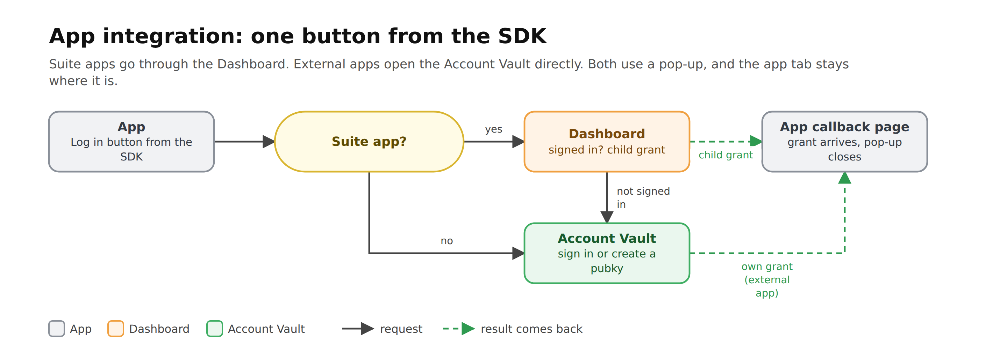

# RFC: Passport as the front end for your pubky

## Purpose

Passport could become the one place where you sign in, sign up, set up your profile, and later manage your homeserver, for every Pubky app. This RFC splits that into features that ship one at a time, and describes Homegate as an optional front door any homeserver operator can run. It builds on RFC 0001 (Accounts signs you in through Passport).

## Goals

- Each feature ships on its own.
- Nothing depends on Synonym: anyone can run a Passport, a Homegate, or a homeserver.
- The key stays where you put it: in the browser or in a Mobile Signer.
- Apps only link Passport. They don't build their own sign-up, onboarding, or profile screens.

## Today

- **Passport:** SSO sign-in with the key in the browser and an encrypted backup with the SSO provider; import, attach, authorized apps, export to Ring. No Mobile Signer QR code, no profiles. Each instance has one fixed Homegate.
- **Passport v2 prototype:** has the Mobile Signer QR code, SMS, Lightning and invite code steps, profile setup, and an instance picker, on an older Passport.
- **Homegate:** verifies by SMS, Lightning, IP address, Google, and Apple, each on only when configured. Serves one homeserver. No endpoint tells a client which methods are on.
- **pubky.app:** runs its own onboarding (verify, install Ring or Bitkit, scan, profile, tags, follows).
- **Pubky Ring:** signs up from a sign-up link. No parent grants yet.
- **SDK:** delegated grants (parent and child) are on the homeserver's main branch, not in the 0.18.0 release.

## Core features

### 1. Mobile Signer sign-in

Passport shows the app's `pubkyauth://` request as a QR code next to the SSO providers. You approve in Ring or Bitkit, and the approval goes through the relay to the app. Passport watches the relay's delivery status and closes once the app has it.

- **Needs:** the QR and relay watch from the v2 prototype.
- **Benefits:** every sign-in method behind one button; the key never leaves the phone.
- **Tradeoffs:** Passport polls the relay while the QR code is open. Legacy `/link` requests show the QR code but Passport can't tell when they finish.

### 2. Identities with the key elsewhere

Passport manages a pubky from a grant instead of a key. The grant comes from:

- **Accounts:** a child grant, so the Mobile Signer isn't needed again.
- **The Mobile Signer:** Ring approves Passport once. Works without Accounts.

- **Needs:** Passport in Accounts' app list, parent grants in Ring, an SDK release with delegated grants.
- **Benefits:** profile and homeserver features for every pubky; no key in the browser.
- **Tradeoffs:** a child grant covers only `/pub/` and `/priv/`, so storage use and grant lists need a Mobile Signer grant. Passport can't approve other apps for you with a grant.

### 3. Profile creation and management

After sign-up, Passport asks for a name, bio, picture, and links before the first app approval. You can skip it and edit it later. Passport writes the same `/pub/social/v1/profile.json` pubky.app writes today (pubky-social-specs), so every app reads one profile.

An app can make the profile required (`profile=required`). Passport then checks the homeserver first:

- **Has a profile:** straight to the grant review.
- **Has none:** the profile step, without skip.
- **Can't write one** (key in Ring, no grant for the profile path): the app gets a "profile required" error.

- **Benefits:** one profile for every app; pubky.app can drop its profile step (tags and follows stay there).
- **Tradeoffs:** Passport follows pubky-social-specs versions. A grant must cover the profile path.

### 4. Onboarding: Passport as the front end for Homegate

1. Select **Create a pubky** and pick a Homegate (from a list, or by address).
2. Passport shows only the methods that Homegate offers: SSO, SMS, or Lightning.
3. You verify and get a sign-up code.
4. Choose where the key lives:
   - **In Pubky Ring or Bitkit:** Passport shows a sign-up QR code. Ring creates the key, signs up, and approves the app in one step.
   - **In this browser:** Passport creates the key and saves a backup with the SSO provider or as a recovery file.
5. Profile step (feature 3), then the grant review. With the key in Ring, the profile needs a grant (feature 2) or stays in the app.

**Invite codes** skip Homegate: Passport checks the code with the homeserver and signs up there directly. This is also how a homeserver without a Homegate takes new users.

- **Needs:** the Homegate discovery endpoint; the SMS, Lightning, and invite code steps from pubky.app or the v2 prototype.
- **Benefits:** full onboarding from one button for every app; no lock-in to one Homegate.
- **Tradeoffs:** screens differ per Homegate. Passport grows. SSO backup needs a Homegate with that provider's backup key switched on. iOS users go to Ring, because Bitkit on iOS can't open sign-up links yet.

## Homegate: an optional front door

Anyone can run a Homegate in front of their homeserver. A homeserver without one still works, with open sign-up or invite codes.

- **Modules:** one module per method (Google, Apple, SMS, Lightning), on only when configured (as today). The Google and Apple modules each have two switches: sign-up check and backup key. So someone who signs up by SMS can still back up with Google, and an operator can offer backups without SSO sign-up.
- **Discovery:** a new `GET /info` returns the homeserver key, the methods that are on, their price and storage, the operator's name, and terms links.
- **Backup key:** the Google and Apple wrapping key endpoints move from Passport into those two modules, with the same key derivation so existing backups still unlock. Passport then needs no server and can run as a static site.
- **Run by anyone:** a Docker image with Postgres and a config file. One homeserver per Homegate.
- **Finding Homegates:** each Passport lists the ones it knows; finding them on the network comes later.

## App integration

Apps add one button from the Passport SDK. It opens a pop-up and the app tab stays. Suite apps go through Accounts; external apps get their own grant.

- The SDK uses `passport.pubky.app` by default; an app or user can pick another instance.
- An app can make the profile required (feature 3).
- The first package, `@pubky/passport-auth`, is in review: sign-in only, no UI.

## Later: homeserver management

Lower priority. Examples:

- **Storage:** see use and buy more from the Homegate.
- **Mirror:** keep a copy on a second homeserver.
- **Export:** download all your files.
- **Move:** switch homeservers and update your pkarr record.
- **Authorized apps:** list and revoke them (done for keys in the browser).
- **Key protection:** a PIN or passkey.

## Terms

- **Mobile Signer:** Pubky Ring or Bitkit.
- **Passport:** the Signer that runs in the browser.
- **Pubky Accounts:** the shared sign-in site for the Pubky suite.
- **Parent and child grant:** one approval that lets Accounts act for you, and the per-app grants Accounts signs.
- **SSO provider:** Google or Apple, which also stores your encrypted backup.
- **Wrapping key (backup key):** unlocks your backup; Homegate's Google or Apple module derives it after checking your sign-in with that provider.
- **Homegate:** the optional service in front of a homeserver that checks new users and hands out sign-up codes.
