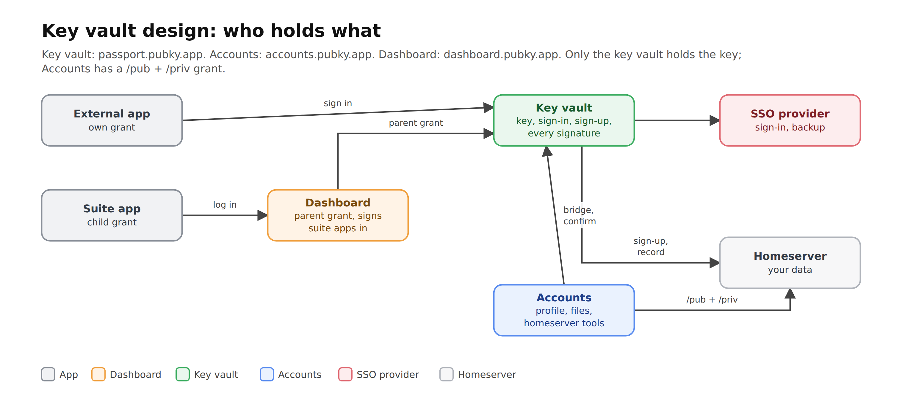
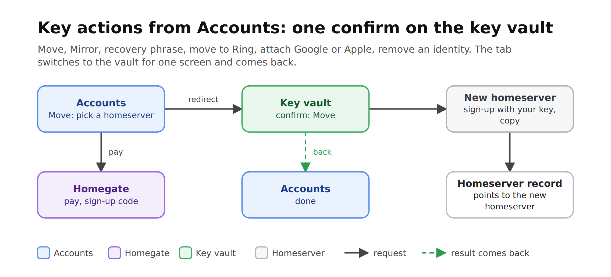
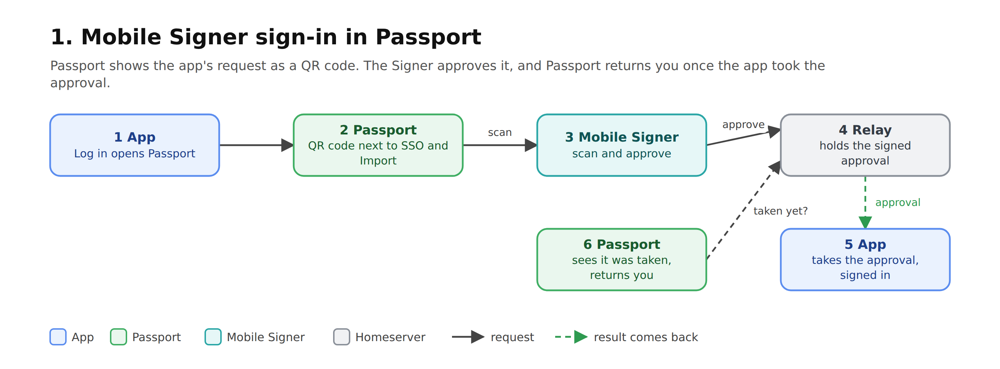
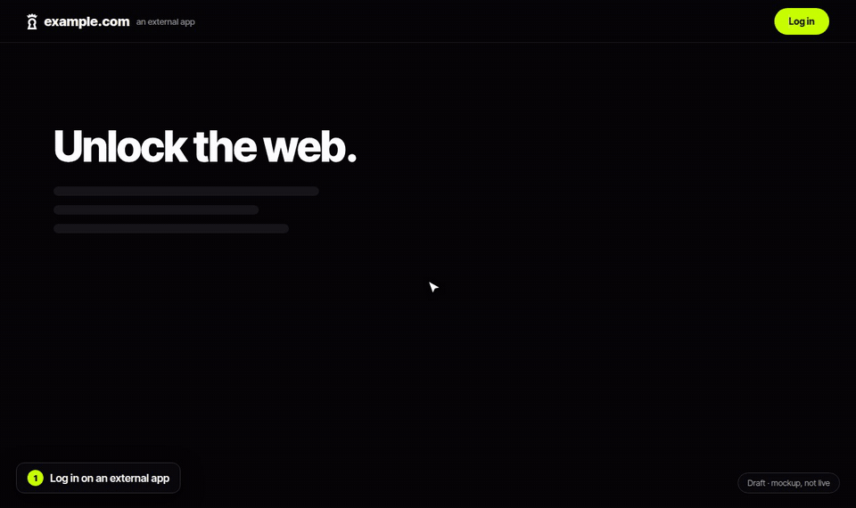
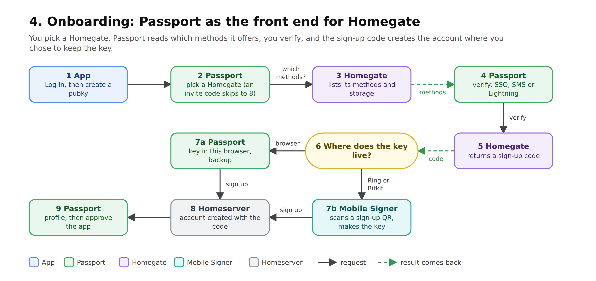
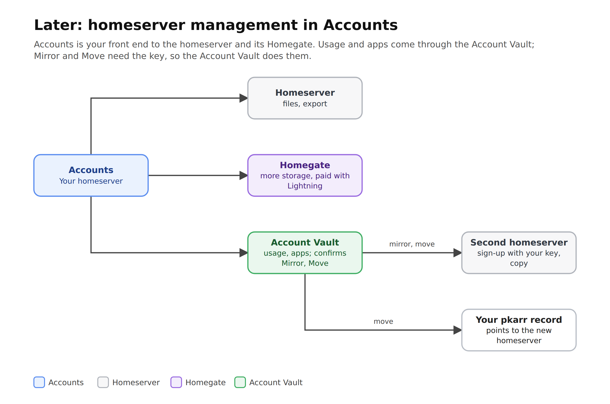

# RFC: Passport as the front end for your pubky

## Purpose

Passport could become the one place where you sign in, sign up, set up your profile, and later manage your homeserver, for every Pubky app. This RFC splits that into features that ship one at a time, and describes Homegate as an optional front door any homeserver operator can run. It builds on RFC 0001 (Accounts signs you in through Passport).

## Goals

- Each feature ships on its own.
- Nothing depends on Synonym: anyone can run a Passport, a Homegate, or a homeserver.
- The key stays where you put it: in the browser or in a Mobile Signer.
- Apps only link Passport. They don't build their own sign-up, onboarding, or profile screens.

## Today

- **Passport:** SSO sign-in with the key in the browser and an encrypted backup with the SSO provider; import, attach, authorized apps, export to Ring. No Mobile Signer QR code, no profiles. Each instance has one fixed Homegate.
- **Passport v2 prototype:** has the Mobile Signer QR code, SMS, Lightning and invite code steps, profile setup, and an instance picker, on an older Passport.
- **Homegate:** verifies by SMS, Lightning, IP address, Google, and Apple, each on only when configured. Serves one homeserver. No endpoint tells a client which methods are on.
- **pubky.app:** runs its own onboarding (verify, install Ring or Bitkit, scan, profile, tags, follows).
- **Pubky Ring:** signs up from a sign-up link. No parent grants yet.
- **SDK:** delegated grants (parent and child) are on the homeserver's main branch, not in the 0.18.0 release.

## Key vault: the key on its own site

Passport keeps the key in the browser storage of `passport.pubky.app`. Profile, files and homeserver tools show data other apps wrote, so in one site a bug there runs next to the key. This proposal splits one codebase across two sites:

- **Key vault** (`passport.pubky.app`): the key, Google and Apple sign-in and backup, the whole sign-in and sign-up pop-up, and every signature behind its own Authorize.
- **Account management** (`accounts.pubky.app`, proposed name Pubky Accounts): profile editing, files and homeserver tools, with a `/pub/` + `/priv/` grant the key vault signs. It never sees the key, the recovery phrase or a Google or Apple token.
- **Pubky Dashboard** (`dashboard.pubky.app`): today's Pubky Accounts under a new name, for the suite.

**Proposed names.** Passport now does more than sign: it signs you up and manages your pubky. Pubky Accounts is really the suite's overview. The names should say what each site does:

- **Pubky Account Vault** (`passport.pubky.app`, today's Passport): holds your keys and signs. This section calls it the key vault. It could later move to `vault.accounts.pubky.app`, but existing keys and backups would have to move with it, because both are tied to the Passport address.
- **Pubky Accounts** (`accounts.pubky.app`, new): where you manage your pubkys: identities, profile, files and homeserver. Plural, because it holds several pubkys. This section calls it account management.
- **Pubky Dashboard** (`dashboard.pubky.app`, today's Pubky Accounts): the suite's overview. It holds the parent grant and signs suite apps in.

Apps don't change: they still link the vault, and the SDK default stays `passport.pubky.app`.

Browsers keep storage per host, so the key vault needs its own host; another path on the same host shares the storage. Both hosts sit under `pubky.app`, which browsers treat as one site.

**Same screens.** The sign-in and sign-up pop-up stays on `passport.pubky.app`, as today. Profile, files and homeserver tools open on `accounts.pubky.app` with the same screens and clicks. Actions that need the key switch the tab to the key vault for one confirm screen, then come back: Move, Mirror, the recovery phrase, move to Ring, attach Google or Apple, remove an identity. Move gets one more click.

**Signing rules**, enforced by the key vault:

- Account management's own `/pub/` + `/priv/` grant is signed with no click, for that client ID and those capabilities only.
- Everything else needs a click on a full key vault page that no other site can frame: grants for other apps, the parent grant, root, homeserver sign-up and record, export.
- Never sent to account management: the key, the recovery phrase, the wrapping key, Google and Apple tokens.

**Bridge.** A hidden key vault page that only `accounts.pubky.app` can frame. It returns public keys, storage use and the grant list, signs account management's own grant, and revokes apps. It has no buttons and never opens Google or Apple sign-in. Both hosts are one site, so browsers don't split its storage the way they would for Passport framed inside another site.

**What it stops.** A bug or bad dependency on account management gets at most a revocable `/pub/` + `/priv/` grant. It can't take the key, sign for other apps or move your homeserver. It doesn't help if the key vault itself is compromised, so the key vault stays small and never shows content other apps wrote.

**Self-hosting.** One image, two hostnames (`VAULT_ORIGIN`, `ACCOUNTS_ORIGIN`). Setting both to one host runs it as today, without the split. Apps still only know the key vault address, and the SDK default stays `passport.pubky.app`. Homegate and homeserver choice don't change.

**Codebase.** Key code moves to `src/vault/` and account management to `src/accounts/`. Lint rules block imports between them, and CI checks that the account management bundle has no key code. `proxy.ts` routes each host and sets its headers.

- **Needs:** host routing, the bridge, the signing rules. Google and Apple stay registered for `passport.pubky.app` only.
- **Benefits:** the key never shares a site with profile, files or homeserver tools. Passport stays a small signer.
- **Tradeoffs:** one more hostname to run. Key actions started in account management switch sites for one screen. Screens say Pubky Accounts while the sign-in pop-up shows `passport.pubky.app`.

## Core features

### 1. Mobile Signer sign-in

Passport shows the app's `pubkyauth://` request as a QR code next to the SSO providers. You approve in Ring or Bitkit, and the approval goes through the relay to the app. Passport watches the relay's delivery status and closes once the app has it.

- **Needs:** the QR and relay watch from the v2 prototype.
- **Benefits:** every sign-in method behind one button; the key never leaves the phone.
- **Tradeoffs:** Passport polls the relay while the QR code is open. Legacy `/link` requests show the QR code but Passport can't tell when they finish.
- **With the key vault split:** on the key vault, part of the sign-in pop-up.

### 2. Identities with the key elsewhere

Passport manages a pubky from a grant instead of a key. The grant comes from:

- **Accounts:** a child grant, so the Mobile Signer isn't needed again.
- **The Mobile Signer:** Ring approves Passport once. Works without Accounts.

- **Needs:** Passport in Accounts' app list, parent grants in Ring, an SDK release with delegated grants.
- **Benefits:** profile and homeserver features for every pubky; no key in the browser.
- **Tradeoffs:** a child grant covers only `/pub/` and `/priv/`, so storage use and grant lists need a Mobile Signer grant. Passport can't approve other apps for you with a grant.
- **With the key vault split:** account management uses these grants the same way. The key vault keeps no key for these pubkys.

### 3. Profile creation and management

After sign-up, Passport asks for a name, bio, picture, and links before the first app approval. You can skip it and edit it later. Passport writes the same `/pub/social/v1/profile.json` pubky.app writes today (pubky-social-specs), so every app reads one profile.

An app can make the profile required (`profile=required`). Passport then checks the homeserver first:

- **Has a profile:** straight to the grant review.
- **Has none:** the profile step, without skip.
- **Can't write one** (key in Ring, no grant for the profile path): the app gets a "profile required" error.

- **Benefits:** one profile for every app; pubky.app can drop its profile step (tags and follows stay there).
- **Tradeoffs:** Passport follows pubky-social-specs versions. A grant must cover the profile path.
- **With the key vault split:** the profile step at sign-up stays in the key vault pop-up; it only writes what you type and checks that a profile exists. Editing later runs on account management.

### 4. Onboarding: Passport as the front end for Homegate

1. Select **Create a pubky** and pick a Homegate (from a list, or by address).
2. Passport shows only the methods that Homegate offers: SSO, SMS, or Lightning.
3. You verify and get a sign-up code.
4. Choose where the key lives:
   - **In Pubky Ring or Bitkit:** Passport shows a sign-up QR code. Ring creates the key, signs up, and approves the app in one step.
   - **In this browser:** Passport creates the key and saves a backup with the SSO provider or as a recovery file.
5. Profile step (feature 3), then the grant review. With the key in Ring, the profile needs a grant (feature 2) or stays in the app.

**Invite codes** skip Homegate: Passport checks the code with the homeserver and signs up there directly. This is also how a homeserver without a Homegate takes new users.

- **Needs:** the Homegate discovery endpoint; the SMS, Lightning, and invite code steps from pubky.app or the v2 prototype.
- **Benefits:** full onboarding from one button for every app; no lock-in to one Homegate.
- **Tradeoffs:** screens differ per Homegate. Passport grows. SSO backup needs a Homegate with that provider's backup key switched on. iOS users go to Ring, because Bitkit on iOS can't open sign-up links yet.
- **With the key vault split:** every onboarding step stays on the key vault. The Google or Apple sign-up check uses the same ID token as the backup key, so it can't move.

## Homegate: an optional front door

Anyone can run a Homegate in front of their homeserver. A homeserver without one still works, with open sign-up or invite codes.

- **Modules:** one module per method (Google, Apple, SMS, Lightning), on only when configured (as today). The Google and Apple modules each have two switches: sign-up check and backup key. So someone who signs up by SMS can still back up with Google, and an operator can offer backups without SSO sign-up.
- **Discovery:** a new `GET /info` returns the homeserver key, the methods that are on, their price and storage, the operator's name, and terms links.
- **Backup key:** the Google and Apple wrapping key endpoints move from Passport into those two modules, with the same key derivation so existing backups still unlock. Passport then needs no server and can run as a static site.
- **Run by anyone:** a Docker image with Postgres and a config file. One homeserver per Homegate.
- **Finding Homegates:** each Passport lists the ones it knows; finding them on the network comes later.

## App integration

Apps add one button from the Passport SDK. It opens a pop-up and the app tab stays. Suite apps go through Accounts; external apps get their own grant.

- The SDK uses `passport.pubky.app` by default; an app or user can pick another instance.
- An app can make the profile required (feature 3).
- The first package, `@pubky/passport-auth`, is in review: sign-in only, no UI.
- With the key vault split, apps still link only `passport.pubky.app`; they never need the account management address.

## Later: homeserver management

Lower priority. Examples:

- **Files:** browse what each app saved on your homeserver, by folder, and download or delete it.
- **Storage:** see use and buy more from the Homegate.
- **Mirror:** keep a copy on a second homeserver.
- **Export:** download all your files.
- **Move:** switch homeservers and update your pkarr record.
- **Authorized apps:** list and revoke them (done for keys in the browser).
- **Key protection:** a PIN or passkey.

With the key vault split, these run on account management. Storage use and the app list come through the bridge; Move, Mirror and key protection confirm on the key vault.

## Terms

- **Mobile Signer:** Pubky Ring or Bitkit.
- **Passport:** the Signer that runs in the browser. With the key vault split, it becomes Pubky Account Vault.
- **Pubky Accounts:** today, the shared sign-in site for the Pubky suite. With the key vault split, it becomes Pubky Dashboard and the name moves to account management.
- **Parent and child grant:** one approval that lets Accounts act for you, and the per-app grants Accounts signs.
- **SSO provider:** Google or Apple, which also stores your encrypted backup.
- **Wrapping key (backup key):** unlocks your backup; Homegate's Google or Apple module derives it after checking your sign-in with that provider.
- **Pubky Account Vault (key vault):** proposed name for Passport when it's split; `passport.pubky.app`, the only site that holds the key.
- **Account management:** `accounts.pubky.app` when Passport is split (proposed name Pubky Accounts); identities, profile, files and homeserver tools with a grant.
- **Pubky Dashboard:** proposed new name for Pubky Accounts at `dashboard.pubky.app`.
- **Homegate:** the optional service in front of a homeserver that checks new users and hands out sign-up codes.
