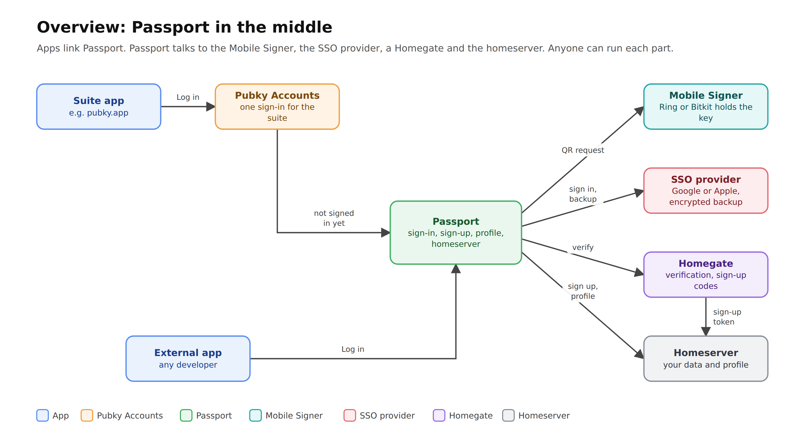
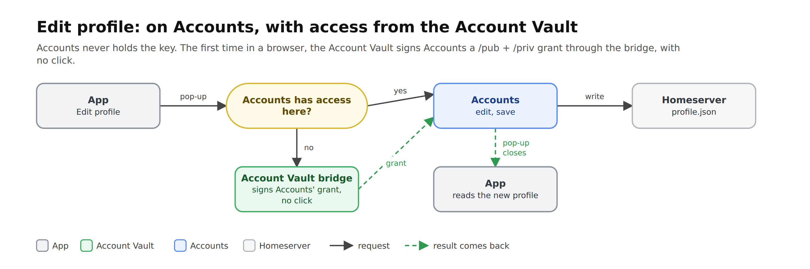
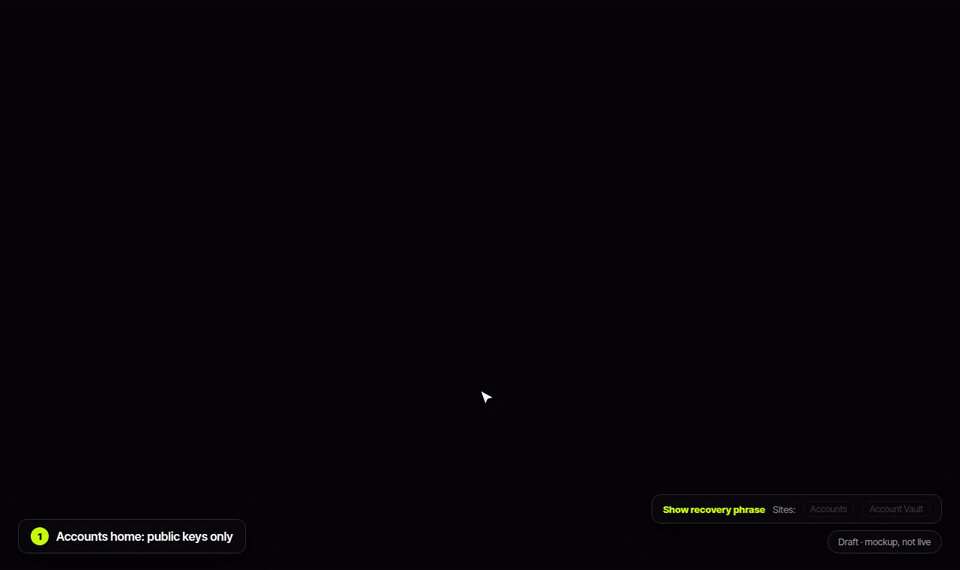
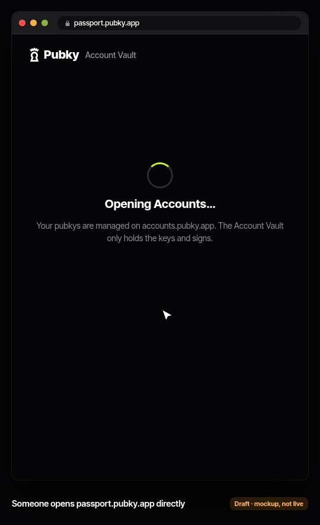
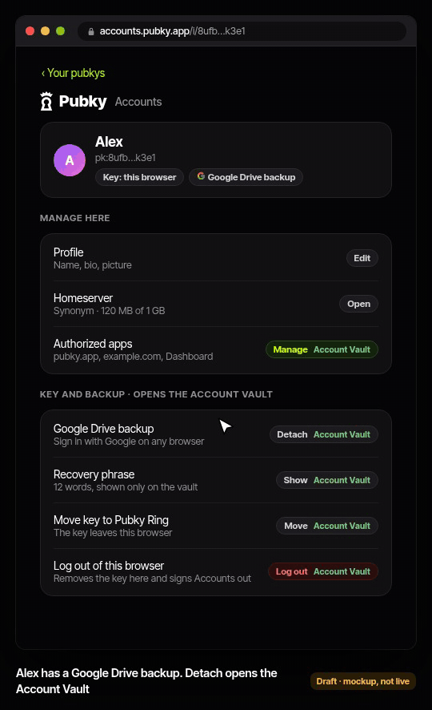
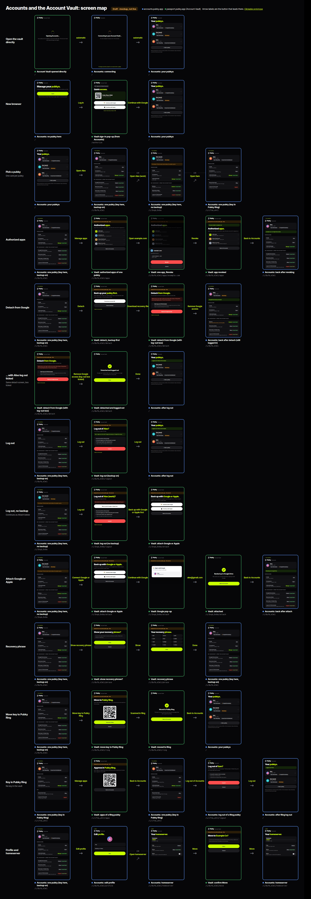
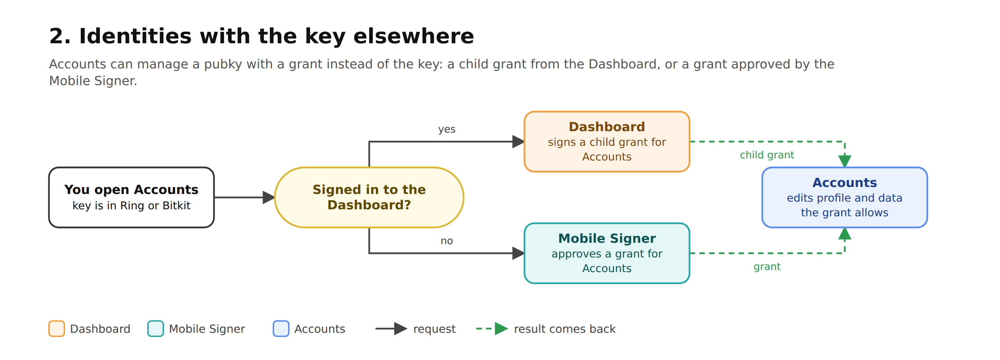
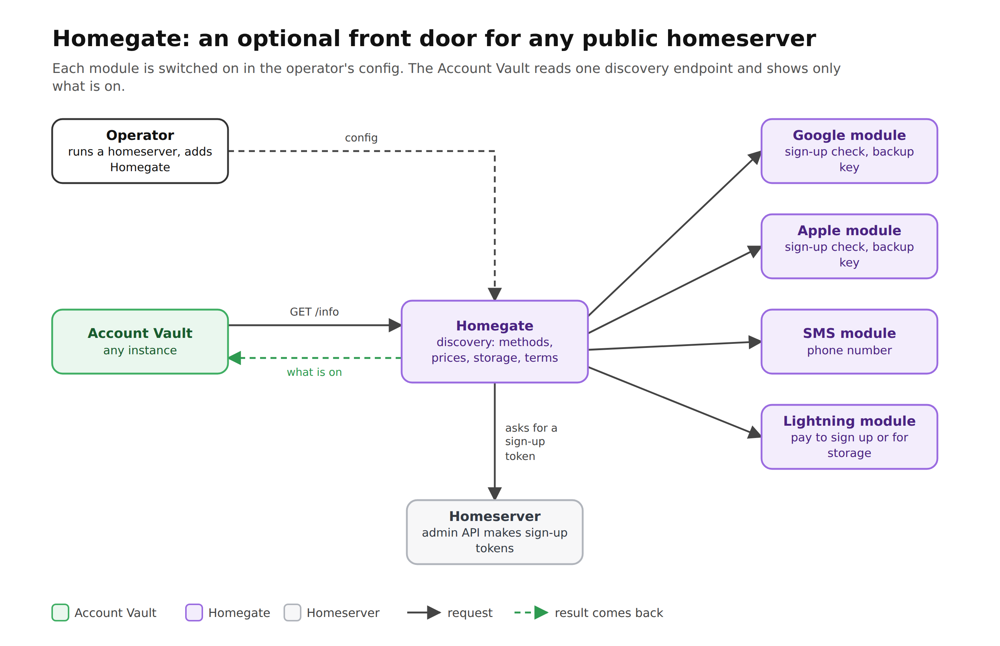

# RFC: Account Vault and Accounts, the front end for your pubky

## Purpose

Passport could become the one place where you sign in, sign up, set up your profile, and later manage your homeserver, for every Pubky app. This RFC splits that work across two sites from one codebase, so the key never shares a site with the rest. It also splits the features so they ship one at a time, and describes Homegate as an optional front door any homeserver operator can run. It builds on RFC 0001, where Pubky Accounts (here: Pubky Dashboard) signs you in through Passport (here: Pubky Account Vault).

## Names

Passport now does more than sign: it signs you up and manages your pubky. Today's Pubky Accounts is really the suite's overview. The proposed names say what each site does:

- **Pubky Account Vault** (`passport.pubky.app`, today's Passport): holds your keys and signs. It could later move to `vault.accounts.pubky.app`, but existing keys and backups would have to move with it, because both are tied to the Passport address.
- **Pubky Accounts** (`accounts.pubky.app`, new): where you manage your pubkys: identities, profile, files and homeserver. Plural, because it holds several pubkys.
- **Pubky Dashboard** (`dashboard.pubky.app`, today's Pubky Accounts): the suite's overview. It holds the parent grant and signs suite apps in.

Apps don't change: they link the Account Vault, and the SDK default stays `passport.pubky.app`.

## Goals

- Each feature ships on its own.
- Nothing depends on Synonym: anyone can run an Account Vault with Accounts, a Homegate, or a homeserver.
- The key stays where you put it: in the Account Vault in your browser, or in a Mobile Signer. No other site sees it.
- Apps only link the Account Vault. They don't build their own sign-up, onboarding, or profile screens.

## Today

- **Passport** (to become the Account Vault): SSO sign-in with the key in the browser and an encrypted backup with the SSO provider; import, attach, authorized apps, export to Ring. No Mobile Signer QR code, no profiles. Each instance has one fixed Homegate.
- **Passport v2 prototype:** has the Mobile Signer QR code, SMS, Lightning and invite code steps, profile setup, and an instance picker, on an older Passport.
- **Pubky Accounts** (to become the Dashboard): a prototype that holds a parent grant and signs suite apps in with child grants.
- **Homegate:** verifies by SMS, Lightning, IP address, Google, and Apple, each on only when configured. Serves one homeserver. No endpoint tells a client which methods are on.
- **pubky.app:** runs its own onboarding (verify, install Ring or Bitkit, scan, profile, tags, follows).
- **Pubky Ring:** signs up from a sign-up link. No parent grants yet.
- **SDK:** delegated grants (parent and child) are on the homeserver's main branch, not in the 0.18.0 release.

## Account Vault and Accounts: the key on its own site

Today Passport keeps the key in the browser storage of `passport.pubky.app`. Profile, files and homeserver tools show data other apps wrote, so on one site a bug there runs next to the key. One codebase serves two sites instead:

- **Account Vault** (`passport.pubky.app`): the key, Google and Apple sign-in and backup, the whole sign-in and sign-up pop-up, and every signature behind its own Authorize.
- **Accounts** (`accounts.pubky.app`): identities, profile editing, files and homeserver tools, with a `/pub/` + `/priv/` grant the Account Vault signs. It never sees the key, the recovery phrase or a Google or Apple token.

Browsers keep storage per host, so the Account Vault needs its own host; another path on the same host shares the storage. Both hosts sit under `pubky.app`, which browsers treat as one site.

**Same screens.** The sign-in and sign-up pop-up stays on `passport.pubky.app`, as today. Profile, files and homeserver tools open on `accounts.pubky.app` with the same screens and clicks. Actions that need the key switch the tab to the Account Vault for one screen, then come back: authorized apps, Move, Mirror, the recovery phrase, move to Ring, attach or detach Google or Apple, log out. Move gets one more click.

**Signing rules**, enforced by the Account Vault:

- Accounts' own `/pub/` + `/priv/` grant is signed with no click, for that client ID and those capabilities only.
- Everything else needs a click on a full Account Vault page that no other site can frame: grants for other apps, the Dashboard's parent grant, root, homeserver sign-up and record, export.
- Never sent to Accounts: the key, the recovery phrase, the wrapping key, Google and Apple tokens.

**Bridge.** A hidden Account Vault page that only `accounts.pubky.app` can frame. It returns public keys, key location and backup, storage use and the app list, and signs Accounts' own grant. It changes nothing else: revoking an app, log out and every key action open a vault page. It has no buttons and never opens Google or Apple sign-in. Both hosts are one site, so browsers don't split its storage the way they would for a vault framed inside another site.

**What it stops.** A bug or bad dependency on Accounts gets at most a revocable `/pub/` + `/priv/` grant. It can't take the key, sign for other apps or move your homeserver. It doesn't help if the Account Vault itself is compromised, so the Account Vault stays small and never shows content other apps wrote.

**Self-hosting.** One image, two hostnames (`VAULT_ORIGIN`, `ACCOUNTS_ORIGIN`). Setting both to one host runs it as today, without the split. Apps still only know the Account Vault address. Homegate and homeserver choice don't change.

**Codebase.** Key code moves to `src/vault/` and Accounts to `src/accounts/`. Lint rules block imports between them, and CI checks that the Accounts bundle has no key code. `proxy.ts` routes each host and sets its headers.

- **Needs:** host routing, the bridge, the signing rules. Google and Apple stay registered for `passport.pubky.app` only.
- **Benefits:** the key never shares a site with profile, files or homeserver tools. The Account Vault stays a small signer.
- **Tradeoffs:** one more hostname to run. Key actions started in Accounts switch sites for one screen. The bridge still needs a check in Chrome, Firefox, Safari and Brave, including private modes.

### Moving between Accounts and the Account Vault

Accounts is the overview. The Account Vault opens only for actions that need the key, always for one pubky.

- **Direct visits:** `passport.pubky.app/` redirects to Accounts. The vault keeps the sign-in pop-up, the action pages and the bridge.
- **Your pubkys:** Accounts lists every pubky it can reach. Name and picture come from the profile; key location (this browser or Ring) and backup (Google Drive, iCloud or none) come from the bridge. Pubkys with the key in Ring come from a Dashboard child grant or a Ring grant. Add a pubky opens the same vault pop-up apps use.
- **One pubky:** profile, homeserver and the app list are on Accounts. Rows that need the key carry an Account Vault tag.
- **Action links:** such a row sends the same tab to `passport.pubky.app/i/<pubky>/<action>?return=<Accounts path>`, with the actions `apps`, `phrase`, `ring`, `attach`, `detach`, `logout`, `move` and `mirror`. The vault page names the pubky and says it was opened from Accounts. Back and Done go to the return path, which must be on the paired Accounts host. The vault sends no result back; Accounts reads the new state through the bridge.
- **Authorized apps:** Accounts shows the list. Manage opens the vault on that pubky's apps, with today's app dialog and Revoke.
- **Log out:** on the vault. The key leaves this browser, Accounts' grant for that pubky is revoked and the vault's own sessions end. The Dashboard and apps keep their grants. With no backup, the page asks for one first.
- **Detach from Google or Apple:** today's steps plus one optional box, off by default: "Also log out of this browser". Ticked, Remove also logs out as above, so Accounts is signed out of that pubky too.
- **Attach Google or Apple:** today's attach screen on the vault, then back to Accounts.
- **Key in Ring:** listing and revoking apps need root, so the vault asks Ring for a short root grant by QR (open: Ring support). Log out runs on Accounts alone: it revokes Accounts' own grant, and the key stays in Ring.

Every screen and the button that leads to it, for design:

Clickable version of the same screens: [prototype](https://8120--main--hermes-main--gil.coder.riginode.xyz/accounts-vault-screens/) (draft, mockup).

## Core features

### 1. Mobile Signer sign-in

The Account Vault shows the app's `pubkyauth://` request as a QR code next to the SSO providers. You approve in Ring or Bitkit, and the approval goes through the relay to the app. The Account Vault watches the relay's delivery status and closes once the app has it.

- **Runs on:** the Account Vault, in the sign-in pop-up.
- **Needs:** the QR and relay watch from the v2 prototype.
- **Benefits:** every sign-in method behind one button; the key never leaves the phone.
- **Tradeoffs:** the Account Vault polls the relay while the QR code is open. Legacy `/link` requests show the QR code but the Account Vault can't tell when they finish.

### 2. Identities with the key elsewhere

Accounts manages a pubky from a grant instead of a key. The grant comes from:

- **The Dashboard:** a child grant, so the Mobile Signer isn't needed again.
- **The Mobile Signer:** Ring approves Accounts once. Works without the Dashboard.

- **Runs on:** Accounts. The Account Vault keeps no key for these pubkys.
- **Needs:** Accounts in the Dashboard's app list, parent grants in Ring, an SDK release with delegated grants.
- **Benefits:** profile and homeserver features for every pubky; no key in the browser.
- **Tradeoffs:** a child grant covers only `/pub/` and `/priv/`, so storage use and grant lists need a Mobile Signer grant. Accounts can't approve other apps for you with a grant.

### 3. Profile creation and management

After sign-up, the Account Vault asks for a name, bio, picture, and links before the first app approval. You can skip it and edit it later in Accounts. Both write the same `/pub/social/v1/profile.json` pubky.app writes today (pubky-social-specs), so every app reads one profile.

An app can make the profile required (`profile=required`). The Account Vault then checks the homeserver first:

- **Has a profile:** straight to the grant review.
- **Has none:** the profile step, without skip.
- **Can't write one** (key in Ring, no grant for the profile path): the app gets a "profile required" error.

- **Runs on:** the Account Vault at sign-up (it only writes what you type and checks that a profile exists); Accounts for editing later.
- **Benefits:** one profile for every app; pubky.app can drop its profile step (tags and follows stay there).
- **Tradeoffs:** both sites follow pubky-social-specs versions. A grant must cover the profile path.

### 4. Onboarding: the Account Vault as the front end for Homegate

1. Select **Create a pubky** and pick a Homegate (from a list, or by address).
2. The Account Vault shows only the methods that Homegate offers: SSO, SMS, or Lightning.
3. You verify and get a sign-up code.
4. Choose where the key lives:
   - **In Pubky Ring or Bitkit:** the Account Vault shows a sign-up QR code. Ring creates the key, signs up, and approves the app in one step.
   - **In this browser:** the Account Vault creates the key and saves a backup with the SSO provider or as a recovery file.
5. Profile step (feature 3), then the grant review. With the key in Ring, the profile needs a grant (feature 2) or stays in the app.

**Invite codes** skip Homegate: the Account Vault checks the code with the homeserver and signs up there directly. This is also how a homeserver without a Homegate takes new users.

- **Runs on:** the Account Vault, every step, including the Homegate client. The Google or Apple sign-up check uses the same ID token as the backup key.
- **Needs:** the Homegate discovery endpoint; the SMS, Lightning, and invite code steps from pubky.app or the v2 prototype.
- **Benefits:** full onboarding from one button for every app; no lock-in to one Homegate.
- **Tradeoffs:** screens differ per Homegate. The Account Vault grows. SSO backup needs a Homegate with that provider's backup key switched on. iOS users go to Ring, because Bitkit on iOS can't open sign-up links yet.

## Homegate: an optional front door

Anyone can run a Homegate in front of their homeserver. A homeserver without one still works, with open sign-up or invite codes.

- **Modules:** one module per method (Google, Apple, SMS, Lightning), on only when configured (as today). The Google and Apple modules each have two switches: sign-up check and backup key. So someone who signs up by SMS can still back up with Google, and an operator can offer backups without SSO sign-up.
- **Discovery:** a new `GET /info` returns the homeserver key, the methods that are on, their price and storage, the operator's name, and terms links.
- **Backup key:** the Google and Apple wrapping key endpoints move from the Account Vault into those two modules, with the same key derivation so existing backups still unlock. The Account Vault then needs no server and can run as a static site.
- **Run by anyone:** a Docker image with Postgres and a config file. One homeserver per Homegate.
- **Finding Homegates:** each Account Vault lists the ones it knows; finding them on the network comes later.

## App integration

Apps add one button from the SDK. It opens a pop-up and the app tab stays. Suite apps go through the Dashboard; external apps open the Account Vault and get their own grant.

- The SDK uses `passport.pubky.app` by default; an app or user can pick another instance.
- Apps never need the Accounts address.
- An app can make the profile required (feature 3).
- The first package, `@pubky/passport-auth`, is in review: sign-in only, no UI.

## Later: homeserver management

Lower priority. These run on Accounts:

- **Files:** browse what each app saved on your homeserver, by folder, and download or delete it.
- **Storage:** see use and buy more from the Homegate.
- **Mirror:** keep a copy on a second homeserver.
- **Export:** download all your files.
- **Move:** switch homeservers and update your pkarr record.
- **Authorized apps:** the list on Accounts, Revoke on the Account Vault (done for keys in the browser).
- **Key protection:** a PIN or passkey on the Account Vault.

Storage use and the app list come through the bridge. Mirror, Move and key protection need the key, so they confirm on the Account Vault.

## Terms

- **Pubky Account Vault:** `passport.pubky.app`, today's Passport. The only site that holds the key; signs in, signs up and signs.
- **Pubky Accounts:** `accounts.pubky.app`, new. Manages your pubkys (identities, profile, files, homeserver) with a grant from the Account Vault, the Dashboard or a Mobile Signer.
- **Pubky Dashboard:** `dashboard.pubky.app`, today's Pubky Accounts. The suite's sign-in and overview.
- **Passport:** today's name for the Account Vault, and for the codebase that serves both the Account Vault and Accounts.
- **Bridge:** a hidden Account Vault page that Accounts frames to read public data and get its grant.
- **Mobile Signer:** Pubky Ring or Bitkit.
- **Parent and child grant:** one approval that lets the Dashboard act for you, and the per-app grants the Dashboard signs.
- **SSO provider:** Google or Apple, which also stores your encrypted backup.
- **Wrapping key (backup key):** unlocks your backup; Homegate's Google or Apple module derives it after checking your sign-in with that provider.
- **Homegate:** the optional service in front of a homeserver that checks new users and hands out sign-up codes.
