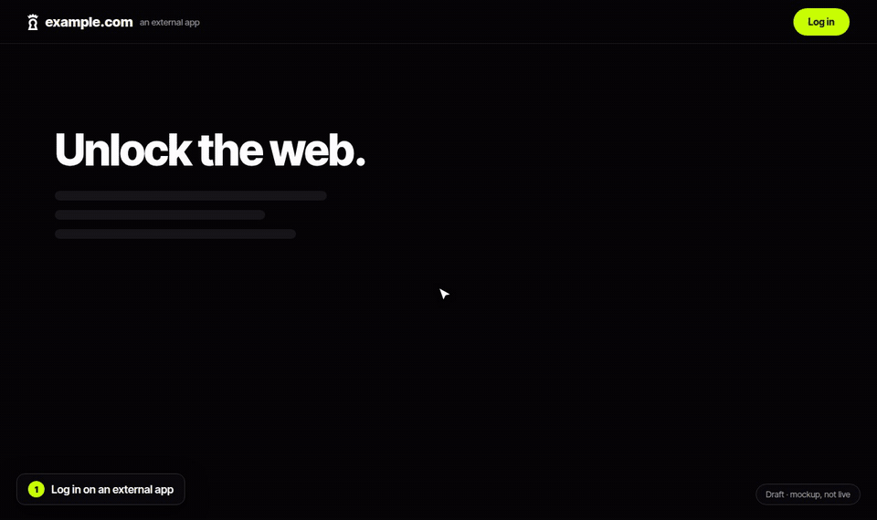
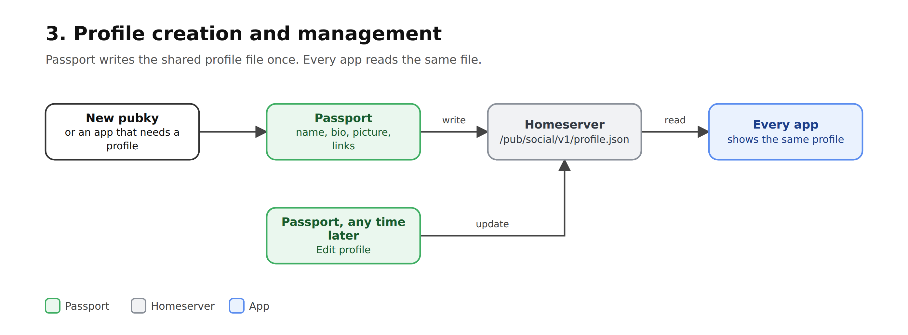

# RFC: Passport as the front end for your pubky

## Purpose

This RFC describes what Passport could become: the one place where you sign in, sign up, set up your profile, and later manage your homeserver, for every Pubky app. It splits that into separate features that can ship one at a time. It also describes Homegate as an optional, modular front door that any homeserver operator can run, and that Passport can read.

RFC 0001 covers how Pubky Accounts signs you in through Passport. This RFC builds on it.

## Goals

- Each feature works on its own and can ship alone.
- Nothing depends on Synonym. Anyone can run a Passport, a Homegate, or a homeserver, and apps can use any Passport.
- The key stays where you put it: in the browser, in a Mobile Signer, or loaded only to sign.
- Apps only link Passport. They don't build their own sign-up, onboarding, or profile screens.

## Today

- Passport signs you in with an SSO provider, keeps the key in the browser, and saves an encrypted backup with the SSO provider. You can import a pubky with a recovery phrase or recovery file, attach a local-only identity to an SSO provider, list and revoke authorized apps, and export a key to Pubky Ring with a QR code.
- Passport's only server routes are the two wrapping key endpoints, one for Google and one for Apple.
- Passport doesn't show a Mobile Signer QR code and doesn't create profiles. Each Passport instance has one Homegate address, and that Homegate decides the homeserver. You can't choose either.
- A Passport v2 prototype already has a Mobile Signer QR code that watches the relay, SMS, Lightning, and invite code sign-up steps, profile setup, and a Passport instance picker in its client package. It's built on an older version of Passport.
- Homegate verifies by SMS, Lightning, IP address, Google, and Apple. Each method is on only when its section is in the config file. A Homegate serves one homeserver and gets sign-up tokens from that homeserver's admin API. No endpoint tells a client which methods are on. Homegate has no wrapping key code.
- pubky.app runs its own onboarding: SMS, Lightning, or an invite code, then install Pubky Ring or Bitkit, scan, profile, tags, and follow suggestions.
- Pubky Ring creates a pubky from a sign-up link that carries a sign-up token, and signs up on the homeserver itself. It has no Homegate code and doesn't support parent grants yet. Bitkit is also a Mobile Signer and gets its sign-up code from Homegate directly.
- Delegated grants (parent and child grants) are on the homeserver's main branch, not in the current SDK release (0.18.0).

## Core features

These four come first. Each one has a short demo and a flowchart.

### 1. Mobile Signer sign-in

Passport shows the app's `pubkyauth://` request as a QR code next to the SSO providers and Import. You scan it with Pubky Ring or Bitkit and approve there. The approval goes through the relay to the app, as it does today when an app shows its own QR code. Passport checks the relay channel's read-only delivery status, without taking the approval, and closes or returns you once the app has it.

What it needs:

- The relay watch and QR screens from the v2 prototype, moved onto current Passport.

Benefits:

- Apps get every sign-in method from one button, including Mobile Signers.
- The key never leaves the phone.

Tradeoffs:

- Passport polls the relay every few seconds while the QR code is open.
- The watch works only for requests with a `secret` on an inbox relay. For legacy `/link` requests, Passport can show the QR code but can't tell when the app has the approval.

### 2. Identities with the key elsewhere

Passport can manage a pubky without holding its key. It works from a grant instead. The grant can come from two places:

- **A child grant from Accounts.** Accounts already holds a parent grant, approved once by a Signer. Passport signs in to Accounts like any suite app and gets a child grant for what it needs, for example the profile path and public data. The Mobile Signer isn't needed again.
- **A grant from the Mobile Signer.** Passport shows a sign-in request with the capabilities it needs, and Ring approves it once. This works without Accounts, for example for people who don't use the Pubky suite.

The same idea works for SSO identities: Passport could keep only a grant and load the key from the backup when it has to sign. That costs an SSO sign-in each time.

What it needs:

- Passport in Accounts' app list with its exact callback URL, and Passport accepting a child grant on that callback.
- Parent grant support in Pubky Ring.
- An SDK release with delegated grants.

Benefits:

- Profile and homeserver features work for every pubky, not only keys in the browser.
- The browser holds no key that could leak.

Tradeoffs:

- A child grant covers at most `/pub/` and `/priv/`. It can't read storage use or list and revoke grants, because those need a session for the whole pubky. Those features need a grant from the Mobile Signer, or stay in the Mobile Signer.
- Passport can't sign as you with a grant, so it can't approve sign-ins for other apps.

### 3. Profile creation and management

After a new pubky signs up, Passport asks for a profile before the first app approval: name, bio, picture, and links. You can skip it. Later you edit the profile from Passport's home page.

Passport writes the shared profile file that pubky.app writes today, `/pub/social/v1/profile.json`, with the picture under `/pub/social/v1/files/`. The format comes from pubky-social-specs, so pubky.app and every other app read the same file.

An app can ask for a profile when it opens Passport. If the pubky has none yet, Passport runs the profile step first. The v2 client package already has this option.

Benefits:

- One profile for every Pubky app, set up once.
- pubky.app can drop its own profile step. Tags and follow suggestions stay in pubky.app, because they are specific to it.

Tradeoffs:

- Passport needs to follow pubky-social-specs versions, including the move from `/pub/pubky.app/` to `/pub/social/v1/`.
- With a grant instead of a key (feature 2), the grant must cover the profile path.

### 4. Onboarding: Passport as the front end for Homegate

New users create their pubky in Passport, wherever they started:

1. You select **Create a pubky** and pick a Homegate. Passport offers its own list, and you can add one by address. If you have an invite code, you skip the Homegate (see below).
2. Passport reads the Homegate's discovery endpoint and shows only the methods that Homegate offers: SSO provider, SMS, or Lightning.
3. You verify. The Homegate returns a sign-up code and its homeserver.
4. You choose where the key lives:
   - **In this browser:** Passport creates the key, signs up on the homeserver, and saves a backup with the SSO provider or as a recovery file.
   - **In Pubky Ring or Bitkit:** Passport turns the app's request into a sign-up request that also carries the homeserver and the sign-up code, and shows it as a QR code. Ring creates the key, signs up, and approves the app in one step, as it does for sign-up links today. Passport watches the relay as in feature 1 and returns you once the app has the approval.
5. With the key in the browser, Passport runs the profile step (feature 3) and then shows the app's grant review. With the key in Ring, Passport has no key to write the profile with, so the profile step needs a grant (feature 2) or stays in the app.

The first demo verifies by SMS and keeps the key in the browser. The second pays with Lightning and hands the sign-up code to Ring.

What it needs:

- The Homegate discovery endpoint (next section).
- The SMS, Lightning, and invite code steps, moved from pubky.app or the v2 prototype.

Invite codes don't go through Homegate. An invite code is a sign-up token the homeserver's operator made with the admin API. Passport checks it with the homeserver's public `GET /signup_tokens/{token}` and signs up on the homeserver with it directly. The invite link has to carry the homeserver's public key next to the code, as Ring's sign-up links already do. This is also how a homeserver with no Homegate takes new users.

Benefits:

- Every app gets the full onboarding from one button, and pubky.app's onboarding moves out of pubky.app.
- No lock-in: each pubky picks its Homegate, or a homeserver with no Homegate.

Tradeoffs:

- The screens differ per Homegate, because each one turns on different methods.
- Passport grows: SMS, Lightning, and profile screens move in from pubky.app.
- SSO backup needs a Homegate with the wrapping key module. A homeserver without one still takes invite codes, but its users keep a recovery file or keep the key in a Mobile Signer.
- pubky.app sends iOS users to Ring for sign-up, because Bitkit on iOS can't open sign-up links yet. Passport needs the same rule.

## Homegate: an optional front door for public homeservers

Homegate becomes a small public protocol between Passport and any homeserver that wants open sign-ups with a check in front. Anyone can run it on top of their homeserver. A homeserver without a Homegate still works, with open sign-up or with codes its operator hands out.

- **Modules.** Each verification method is its own module, on only when the operator configures it. Homegate already works this way. Today it has SSO (Google, Apple), SMS, Lightning, and IP address. A new module could add the wrapping key. Invite codes need no module, because Passport uses them with the homeserver directly.
- **Discovery.** One new endpoint, `GET /info`, returns what Passport needs: the homeserver's public key, the methods that are on and their settings (for example the Lightning price), the storage each method gives, the operator's name, and its terms and privacy links. Passport shows only what is on. The v2 prototype keeps this data in Passport's own config today; it would move to the Homegate that owns it.
- **Wrapping key module.** The two wrapping key endpoints move from Passport's server into Homegate. Homegate must derive the same key as Passport does today: HKDF-SHA256 with the same secret keyring, salt, and info. Otherwise existing backups can't be unlocked. After the move, Passport has no server routes and can run as a static site that anyone hosts.
  - Each SSO identity depends on the Homegate that holds its wrapping key. The backup records which Homegate and key ID to ask.
  - Each Homegate with SSO needs its own Google client ID and Apple Services ID.
- **Run by anyone.** Homegate ships as a Docker image with Postgres and a config file. SMS uses Prelude and Lightning uses PhoenixD today; operators bring their own accounts.
- **Finding Homegates.** Each Passport instance lists the Homegates it knows, and you can add one by address. Finding Homegates on the network, for example a homeserver publishing its Homegate's address, is possible later but not a priority.
- **One homeserver per Homegate,** as today. An operator with several homeservers runs several Homegates.

## App integration

Apps add one button from the Passport SDK. The button opens a pop-up, and the app tab never leaves. Suite apps go through Accounts; external apps open Passport directly and get their own grant. If a pop-up can't open, the same steps run in the tab.

- The SDK takes a Passport address, `passport.pubky.app` by default. An app or a user can pick another Passport instance, as the v2 client package's instance picker does.
- An app can ask for a profile (feature 3).
- The first version of the package, `@pubky/passport-auth`, is in review. It covers sign-in through the pop-up and the callback page, with no UI, so apps draw their own button.

## Later: homeserver management

Lower priority than the core features. Passport could become your front end to your homeserver and its Homegate. Some examples of what it could offer:

- **Storage:** see what you use, and buy more from the Homegate, for example paid with Lightning. The homeserver already reports use per account and has per-user quotas that its admin API can change.
- **Mirror:** keep a copy on a second homeserver. Grants already work on any homeserver in your pkarr record, but nothing copies the data yet.
- **Backup and export:** download all your files. No export for users exists today.
- **Move:** sign up on another homeserver, copy your data, and point your pkarr record at it. The SDK can republish the record; copying the data needs a new helper.
- **Authorized apps:** list and revoke them. Passport already does this for keys in the browser.
- **Stronger key protection:** a PIN or a passkey in front of the key in the browser.

## Full flow

A new user on an external app, from start to finish:

1. The app shows one Log in button from the Passport SDK. It opens Passport in a pop-up.
2. The user has no pubky, so they select **Create a pubky** (feature 4).
3. They pick a Homegate, verify with one of its methods, and get a sign-up code.
4. They keep the key in the browser with an SSO backup, or in Ring (feature 4, then feature 1 for later sign-ins).
5. Passport asks for a profile and writes it to the homeserver (feature 3).
6. They approve the app's grant, and the pop-up closes.
7. Later, they open Passport to edit the profile or manage storage. If the key is in Ring, Passport works from a grant (feature 2).

## Suggested order

1. Mobile Signer sign-in. Most of it exists in the v2 prototype.
2. Profile creation and management.
3. Homegate discovery endpoint, then onboarding in Passport.
4. Wrapping key module in Homegate.
5. Identities with the key elsewhere. It waits on the SDK release with delegated grants and on parent grants in Ring.
6. Homeserver management.

## Terms

- Mobile Signer: Pubky Ring or Bitkit.
- Passport (Pubky Passport): the Signer that runs in the browser.
- Pubky Accounts: the shared sign-in site for the Pubky suite. It isn't a Signer.
- Parent grant and child grant: one approval that lets Accounts act for you, and the per-app grants Accounts signs with its own key.
- SSO provider: the cloud account you sign in to Passport with, which also stores your encrypted backup. Today: Google and Apple.
- Wrapping key: the key that unlocks your encrypted backup. A server derives it after it checks your SSO provider sign-in.
- Homegate: the optional service in front of a homeserver that checks new users and hands out sign-up codes.
- Homegate module: one verification method or service in a Homegate, on only when its operator configures it.
- Discovery endpoint: the Homegate endpoint that tells Passport which modules are on.
- External app: an app outside the Pubky suite.
